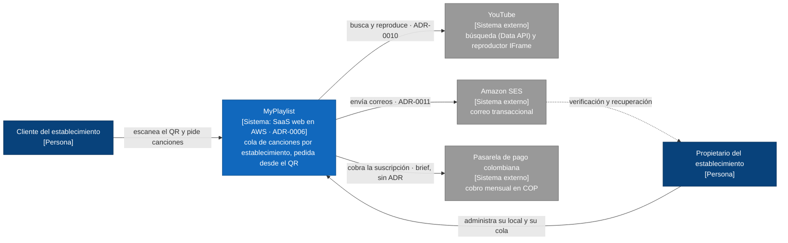
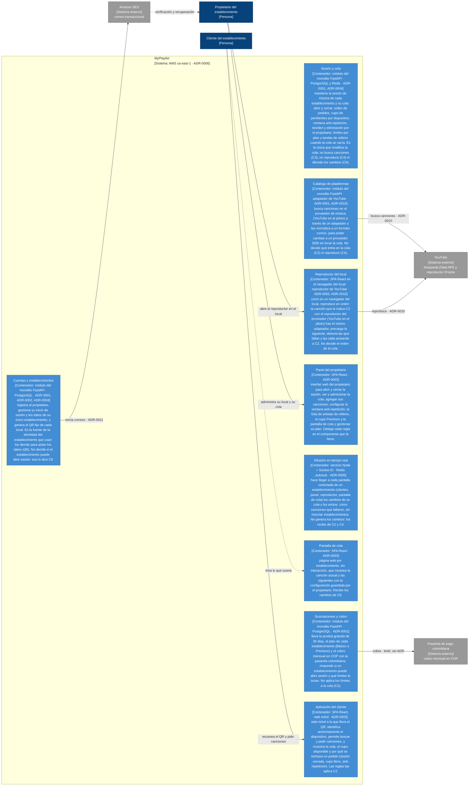
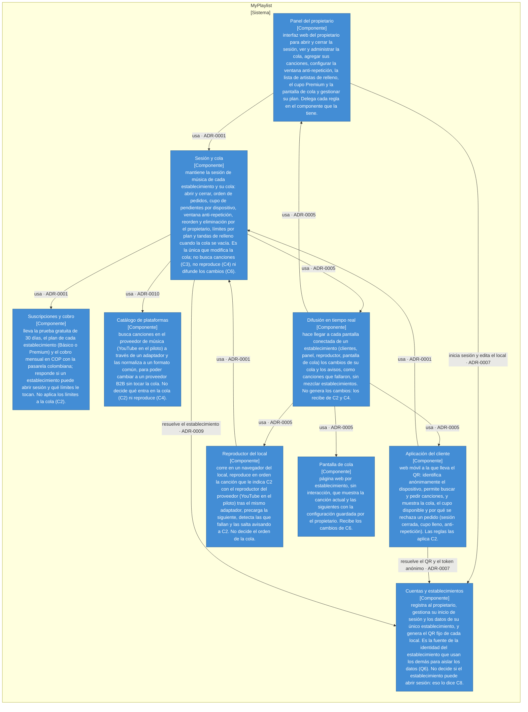

# Diagramas de arquitectura

| Campo  | Valor |
| ------ | ----- |
| Estado | Approved · 6fb18dd48fe8 |

> Vistas C4 de contexto, contenedores y componentes, en Mermaid. Los nodos
> de componente se llaman por su ID (C1) y la comprobación los contrasta con
> components.md y standards.md. Solo el usuario cambia el Estado, con
> /architecture:approve.

## Contexto

Quién usa el sistema y con qué sistemas externos habla.

## Contenedores

Las piezas desplegables o almacenes del sistema y quién las usa.

## Componentes

Las partes del sistema y sus dependencias, cada una con la decisión (ADR) de la que sale.

