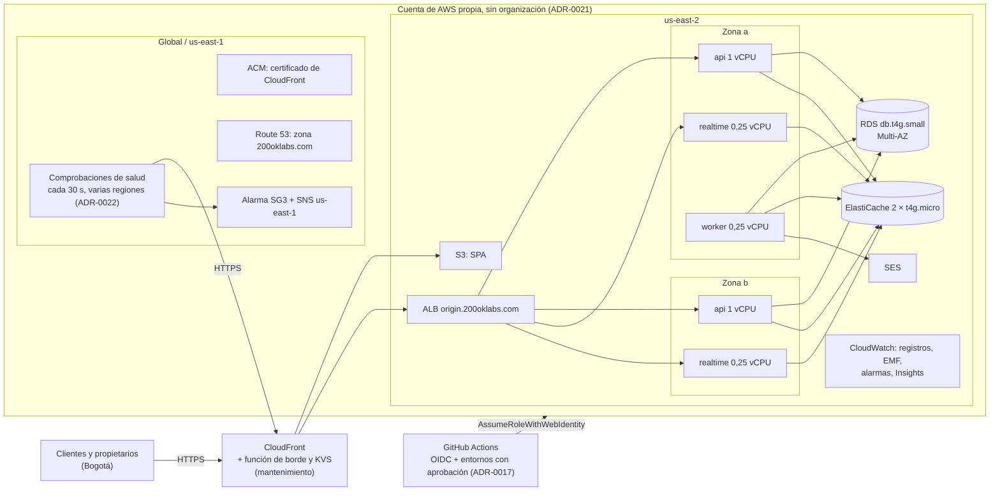
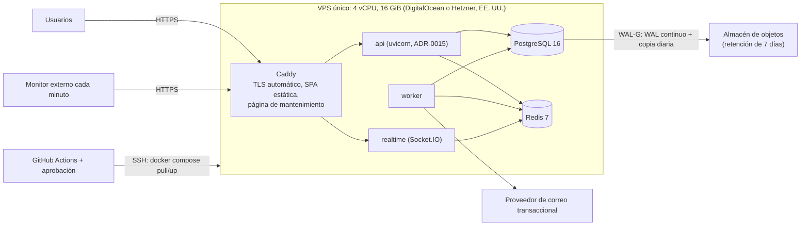

# Evaluación: dónde desplegar MyPlaylist tras el bloqueo de la cuenta de AWS

| Campo     | Valor |
| --------- | ----- |
| Fecha     | 2026-11-26 |
| Decisiones | ADR-0021 (Proposed), ADR-0022 (Proposed) |
| Feature   | 004 — Infraestructura y puesta en marcha |

## Veredicto

**Quedarse en AWS, pero en una cuenta propia fuera de la organización, y con una capacidad para el piloto en lugar de la de la hora pico.** Las tres opciones planteadas (GCP, un VPS y Vercel) se descartan:
- **GCP** cuesta lo mismo o más y obliga a reescribirlo todo.
- **Vercel** obliga a cambiar la arquitectura de la aplicación.
- **El VPS** es la mejor de las tres, y queda como plan B: solo es más barato si se acepta incumplir R009. Si se le pide lo mismo que a AWS, cuesta lo mismo.

Lo que bloquea el piloto no es AWS, sino una cuenta que depende de una organización ajena. Cambiar de nube resolvería un problema de cuenta con una reescritura de la infraestructura.

| | AWS, cuenta propia, perfil de piloto (ADR-0021 y 0022) | VPS único | Dos VPS con base de datos gestionada | GCP | Vercel y terceros |
| - | - | - | - | - | - |
| **Coste de producción al mes** | **~US$265** | ~US$155 a 180 | ~US$245 | ~US$400 a 450 | ~US$100 a 250, difícil de prever |
| **Trabajo hasta el piloto** | **2 a 4 días** | 10 a 15 días | 12 a 18 días | 15 a 20 días | 20 a 30 días |
| **Infraestructura actual que se reutiliza** | **~100 %** | ~15 % (las imágenes) | ~15 % | ~10 % | ~5 % |
| **Cumple R009** (perder una instancia o una zona) | Sí | **No** | Casi[^1] | Sí | Depende de terceros |
| **Cumple R010** (copias de 7 días, pérdida máxima de 5 min) | Sí, gestionado | Hay que montarlo (WAL-G) | Sí, gestionado | Sí, gestionado | Depende del plan |
| **OIDC sin claves** (ADR-0017) | Sí | No: clave SSH | No: clave SSH y token | Sí | Token |
| **Correo** (R008) | SES | Hay que contratar un proveedor | Hay que contratar un proveedor | Hay que contratar un proveedor | Hay que contratar un proveedor |
| **Encargados nuevos en la política de tratamiento** | Ninguno | 1 o 2 | 2 o 3 | 2 | 3 o 4 |
| **ADR que se reescriben** | 2 | 5 o más | 5 o más | 5 o más | 8 o más |

[^1]: Los VPS de un mismo centro de datos no se reparten entre zonas independientes como las de AWS.

## Criterios

1. **El trabajo hecho:**
   - 3115 líneas de Terraform en siete módulos y 76 pruebas de `terraform test` que pasan;
   - los flujos `deploy.yml` e `infra.yml`, con aprobación y etiquetas;
   - 18 de las 29 tareas de 004 cerradas;
   - la política de tratamiento, que ya nombra a AWS como encargado en EE. UU.
2. **Lo pragmático frente a lo fácil:**
   - lo pragmático llega antes al piloto sin incumplir requisitos;
   - lo fácil parece rápido, pero pasa la complejidad a la operación o a la aplicación.
3. **La arquitectura vigente:**
   - el monolito con trabajador en varios procesos (ADR-0001, ADR-0015);
   - el tiempo real con Socket.IO, Redis pub/sub y ticket corto (ADR-0005, ADR-0014, S5);
   - PostgreSQL con RLS (ADR-0009);
   - los atributos de calidad: Q2 con 5000 clientes conectados, Q3 con un 99,5 % y Q7 con la Ley 1581;
   - R009, R010, R013, R016 y R022 de 004.
4. **El coste para un MVP de hasta 50 locales,** que empieza con muchos menos.

## Lo que encontró el análisis

### 1. La capacidad aprobada cuesta el doble de lo que el piloto necesita

Producción, tal como está aprobada, cuesta unos **US$500 a 515 al mes en reposo** (`src/infra/README.md`, «Coste», más el canario).
- **Por qué:** está dimensionada para la hora pico de Q2 todo el mes: tareas de la API de 2 vCPU, `db.t4g.medium` y Redis `t4g.small`.
- **Por qué no hace falta:** el autoescalado (D3 del plan) ya cubre la hora pico, así que el mínimo en reposo puede ser mucho menor sin tocar ningún requisito.

Este es el ahorro más grande que hay sobre la mesa, y no exige cambiar de proveedor.

### 2. El VPS solo es barato si se rebajan los requisitos

- **Uno solo, con PostgreSQL y Redis dentro:** cuesta unos US$155 a 180. Pero si se cae la máquina, se cae el servicio hasta que una persona lo restaura: incumple R009, y Q3 queda a merced de un solo equipo.
- **Para cumplir R009:** hacen falta dos VPS, un balanceador, PostgreSQL gestionado con réplica y Valkey gestionado. Unos US$245, prácticamente lo mismo que AWS con el perfil de piloto.
- **Hetzner, el VPS barato de referencia, subió sus precios en junio de 2026:** la CCX23 en EE. UU. pasó de US$39,99 a US$102,99 al mes. La diferencia histórica de 5 a 10 veces ya no existe.
- **Lo que el VPS deja a cargo del único desarrollador:**
  - los parches del sistema operativo y el endurecimiento SSH;
  - las copias continuas de PostgreSQL para R010, y probar que se restauran;
  - la retención de 30 días de los registros con IP (R016);
  - la página de mantenimiento (R014);
  - la preproducción idéntica (R022).

  AWS da todo eso gestionado, o ya está escrito y probado en `src/infra/`.

### 3. GCP no gana en nada que importe aquí

- **Lo que sí cumple:** Cloud Run ya admite WebSocket, con conexiones de hasta 60 min, y Socket.IO reconecta solo. Cloud SQL tiene alta disponibilidad, y el OIDC de GitHub funciona con Workload Identity Federation.
- **El coste:** un socket abierto mantiene la instancia facturada. El tiempo real y la API siempre encendidos, Cloud SQL con alta disponibilidad, Memorystore y el balanceador suman unos US$400 a 450.
- **No tiene correo transaccional propio:** hay que añadir otro proveedor.
- **Exige reescribir los siete módulos y las 76 pruebas.**
- **Lo único que mejora,** la comprobación de disponibilidad desde varias regiones, también lo consigue AWS en una cuenta propia (ADR-0022).

### 4. Vercel cambia la arquitectura de la aplicación, no solo dónde corre

- **La SPA** encajaría perfectamente. Pero eso no resuelve nada, porque CloudFront ya la sirve.
- **Los WebSocket de sus funciones** se cortan a los ~5 minutos. Con 5000 clientes, serían unas 1000 reconexiones por minuto, cada una pidiendo un ticket nuevo (ADR-0014).
- **El trabajador** de ADR-0015, un proceso de larga duración con el correo y el relleno, no tiene dónde correr: habría que pasarlo a colas o a cron.
- **PostgreSQL y Redis** irían en terceros (Neon y Upstash), con Redis pub/sub entre instancias efímeras (S5).
- **Son tres o cuatro encargados nuevos** en la política de tratamiento, y un coste que crece con el tiempo que los sockets están abiertos.
- **Es la opción fácil en el peor sentido:** parece «subir y listo», y obliga a rediseñar C6 y el trabajador.

### 5. Una cuenta de AWS propia quita las tres restricciones de golpe

| Restricción de la organización | Lo que provocó | En la cuenta propia |
| - | - | - |
| Deniega los proveedores OIDC | T009 bloqueada; se plantearon claves de IAM | OIDC según ADR-0017, como estaba diseñado |
| Deniega `ses:PutAccountDetails` | T015 bloqueada; sin correo, no hay R008 | Se pide la salida del sandbox (unas 24 a 48 h) |
| Deniega CloudWatch y SNS en us-east-1 | El canario de US$53 al mes (ADR-0020) | Las comprobaciones de Route 53, por ~US$5 (ADR-0022) |
| Deniega cualquier región que no sea us-east-2 | ADR-0019 | Se mantiene us-east-2: no hay motivo para moverlo |

Al crear una cuenta nueva, confirmar qué créditos de bienvenida de AWS le corresponden. Desde julio de 2025, una cuenta nueva puede recibir créditos de la capa gratuita.

## Coste del perfil de piloto (ADR-0021 y 0022)

Precios de lista en us-east-2, los mismos con los que se comprobó T009, para 730 horas al mes:

| Recurso | Tamaño | Plan aprobado (US$/mes) | Piloto (US$/mes) |
| - | - | - | - |
| ECS `api` | 2 × (2 vCPU, 4 GiB) → 2 × (1 vCPU, 2 GiB) | 144 | 72 |
| ECS `realtime` | 2 × (0,5 vCPU, 1 GiB) → 2 × (0,25 vCPU, 0,5 GiB) | 36 | 18 |
| ECS `worker` | 2 × (0,25 vCPU, 0,5 GiB) → 1 × (0,25 vCPU, 0,5 GiB) | 18 | 9 |
| RDS Multi-AZ y 20 GiB gp3 | `db.t4g.medium` → `db.t4g.small` | 99 | 51 |
| ElastiCache | 2 × `t4g.small` → 2 × `t4g.micro` | 47 | 23 |
| ALB | — | 25 | 25 |
| IP públicas | 8 → 7 | 29 | 26 |
| CloudWatch: registros, métricas y alarmas | menos tareas, menos registros | 25 | 20 |
| Disponibilidad desde fuera | canario → Route 53 (ADR-0022) | 53 | 6 |
| Secrets Manager, la zona, CloudFront, ECR, S3 y SES | — | 14 | 14 |
| **Total en reposo** | | **~490 a 515** | **~265** |

- **La hora pico:** cada tarea extra de la API, de 1 vCPU, cuesta unos US$0,05 por hora. Cuatro horas de pico al día con cuatro tareas extra suman unos US$24 al mes.
- **Por local:** con 50 locales salen unos US$5,3 al mes por local; con 10, unos US$26,5. Es el dato que tiene que cuadrar con el precio del Plan Básico, que todavía no está decidido en el brief.
- **Ahorros posteriores, sin otro ADR:**
  - un Compute Savings Plan a un año (−20 % en Fargate, unos −US$20);
  - instancias reservadas de RDS cuando la capacidad se estabilice.
- **Riesgo conocido:** la `db.t4g.small` tiene créditos de CPU. La prueba de carga (T019) dirá si aguanta Q2. Si no, se sube a `db.t4g.medium` (+US$48) o a `db.m7g.large`.

## Arquitectura de despliegue propuesta

Respecto a lo que hay hoy en `src/infra/`, solo cambian:
- la cuenta;
- los tamaños, que son los valores del módulo raíz e iguales en los dos entornos (R022);
- la comprobación de disponibilidad.

## Plan B: VPS, si el coste no se puede sostener

**Cuándo activarlo:** si antes de tener ingresos el negocio no puede pagar unos US$265 al mes, o si AWS denegara la cuenta nueva o la salida del sandbox de SES. Exige:
- un ADR que sustituya ADR-0021 y ADR-0017 (claves SSH en lugar de OIDC);
- **enmendar R009 de 004:** perder la máquina pasaría a ser «restaurar en menos de N horas con como mucho 5 minutos de pérdida de datos»;
- **cambiar la política de tratamiento:** el proveedor del VPS y el del correo como encargados.

Diseño mínimo:

Coste estimado:

| Recurso | US$/mes |
| - | - |
| El VPS | 103 a 126 |
| El almacén de objetos | 5 |
| El correo | 15 a 20 |
| El monitor | 7 a 29 |
| **Total** | **~155 a 180** |

## Impacto en la feature 004

Si se aceptan ADR-0021 y ADR-0022:

1. **Spec:** no cambia ningún requisito. Solo la línea de privacidad de «Requisitos no funcionales», que cita ADR-0006, pasaría a citar ADR-0021. Es una aclaración.
2. **Plan** (`/sdd:plan`, después `/sdd:approve`):
   - **D3 y D4:** el perfil de piloto;
   - **D12:** Route 53 en lugar del canario;
   - **D16 y D17:** OIDC en la cuenta nueva, y si se recupera el rol de plan;
   - **D18:** se retira, porque ya no hay organización;
   - **el coste** se recalcula.
3. **Tareas** (`/sdd:tasks`, después `/sdd:approve`), como tareas nuevas, sin renumerar:
   - crear la cuenta y aplicar el arranque en ella, y delegar el dominio a la zona nueva. Lo hace el usuario;
   - el perfil de piloto en las variables de producción, con sus pruebas;
   - retirar el canario y crear las comprobaciones de Route 53, con sus pruebas;
   - cerrar T009 (OIDC) y T015 (salida del sandbox) en la cuenta nueva;
   - retomar T018 (el primer despliegue real) y después T019 (la carga), que valida el perfil de piloto.
4. **La cuenta antigua:** destruir los recursos del arranque, cerrar el caso 179460898900807 y, si conviene, pedir a la organización que la retire.

## Lo que haría cambiar este veredicto

- **AWS niega la cuenta nueva o la salida del sandbox de SES:** pasar al plan B.
- **La prueba de carga exige más de unos US$400 al mes en reposo:** volver a comparar con dos VPS.
- **El precio del Plan Básico deja el coste por local por encima de lo que el negocio acepta con los locales esperados en los primeros 6 meses:** pasar al plan B, aceptando la enmienda de R009.
- **La organización responde antes de crear la cuenta nueva y quita las tres restricciones:** se puede seguir en la cuenta actual, con el perfil de piloto (ADR-0021 se ajustaría a «perfil de piloto» y ADR-0022 seguiría aplicando).

## Fuentes de precios y capacidades (consultadas el 2026-11-26)

- [Hetzner: price adjustment](https://docs.hetzner.com/general/infrastructure-and-availability/price-adjustment/) y [heise: subidas de hasta el 200 %](https://heise.de/-11333037)
- [DigitalOcean: precios de Droplets](https://www.digitalocean.com/pricing/droplets) y [PostgreSQL gestionado](https://docs.digitalocean.com/products/databases/postgresql/details/pricing/)
- [Cloud Run: WebSockets](https://docs.cloud.google.com/run/docs/triggering/websockets)
- [Vercel: WebSockets en Functions](https://vercel.com/docs/functions/websockets) y [Ably: límites de duración](https://ably.com/vercel/websockets-on-vercel)
- Los precios de AWS en us-east-2 son los comprobados en T009 (`src/infra/README.md`, «Coste»).
