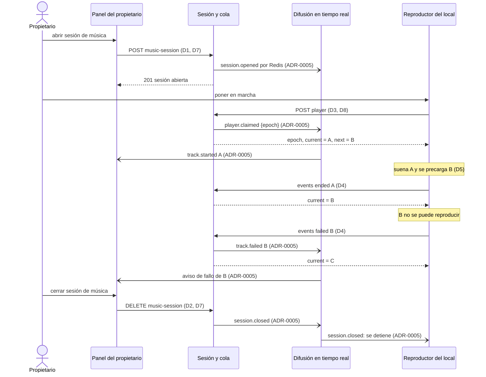
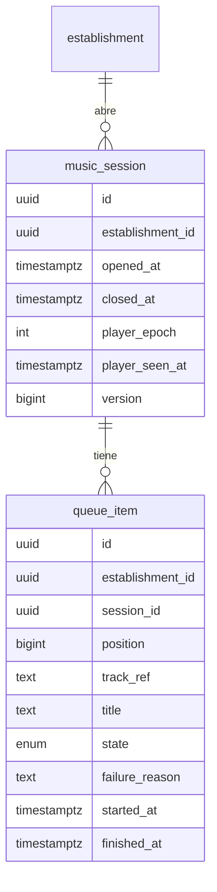
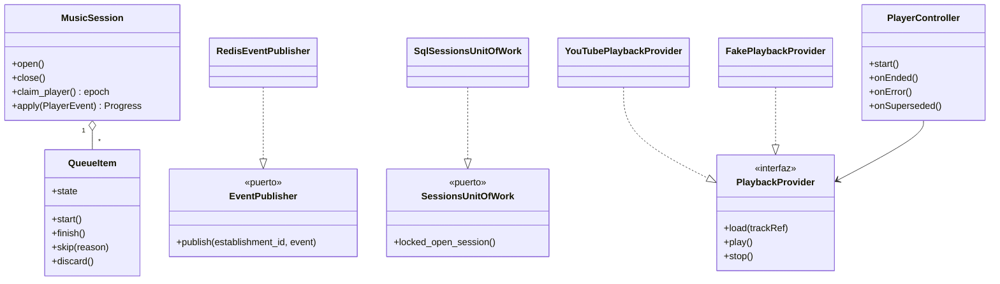

# Plan: Sesión de música y reproductor del local

| Campo  | Valor              |
| ------ | ------------------ |
| Spec   | `spec.md`          |
| Fecha  | 2026-10-21         |
| Estado | Approved · 128be48d1238              |

> Este documento describe **cómo**. Si aquí aparece un requisito nuevo que no
> está en `spec.md`, el sitio correcto es `spec.md`, no aquí.
>
> Solo el usuario cambia el Estado, con `/sdd:approve`.

## Resumen

La feature añade al monolito el módulo de sesión y cola (C2, `src/backend/app/sessions/`). Añade a la SPA el reproductor del local (C4) y la tarjeta de sesión de música del panel (C7). Y crea el servicio de tiempo real (C6, `src/realtime/`), que se usa por primera vez. Hay tres decisiones clave:

- **El servidor decide el avance de la cola.** El reproductor solo informa de que una canción empezó, terminó o falló. C2 aplica la transición dentro de una transacción con la sesión bloqueada, y responde con la siguiente canción. Así se garantiza que cada canción suene una vez (R006) y que nada se repita ni se salte tras un corte (R012).
- **Un único reproductor activo, por épocas.** Poner en marcha un reproductor incrementa la época de la sesión. Cada informe lleva su época, y uno de una época vieja se rechaza (R010). El aviso por tiempo real detiene el reproductor anterior en menos de 1 s.
- **El tiempo real solo difunde.** C2 publica cada cambio por Redis pub/sub (ADR-0005), y C6 lo reenvía a la sala del establecimiento. El panel y el reproductor se autentican en C6 con un ticket de corta duración firmado por el monolito, según **ADR-0014**, que se aprobó junto con este plan.

## Comprobación de constitución

| Regla | ¿Se cumple? | Cómo, o excepción justificada |
| ----- | ----------- | ----------------------------- |
| P1 — La spec es la fuente de verdad | sí | El plan solo cubre R001–R015. No añade requisitos: las canciones solo entran en la cola por una herramienta de desarrollo (D9), porque los pedidos son B03. |
| P2 — Todo MUST con tarea, prueba y criterios | sí | La estrategia de pruebas cubre cada requisito con pruebas `F002_R0xx`. |
| P3 — Aislamiento por establecimiento | sí | Las tablas nuevas llevan `establishment_id` y RLS (D2). El establecimiento sale de la sesión iniciada. Las salas y los canales de Redis llevan el prefijo `est:{id}` (D6). La batería `test_isolation.py` se amplía con las rutas nuevas. |
| P4 — Datos mínimos | sí | La feature no guarda datos personales nuevos. De cada canción solo guarda una referencia opaca del proveedor y el título. |
| P5 — Sin instalación | sí | El reproductor es una ruta de la SPA (D8). |
| P6 — Solo el propietario controla su cola | sí | Solo el propietario abre o cierra la sesión de música, y solo su reproductor hace avanzar la cola, por los casos de uso de C2 (S2). |
| P7 — Decisiones transversales como ADR | sí | La autenticación en el tiempo real se propone como ADR-0014. |
| P8 — Código bajo `src/` | sí | `src/backend/app/sessions/`, `src/realtime/` y `src/web/src/features/{player,music-session}/`. |
| Estándares de código | sí | `src/realtime/` sigue las mismas reglas que la web: TypeScript estricto, eslint, Vitest y Node 22. Se añade al CI (D9). |
| Pruebas de integración contra PostgreSQL real | sí | Las de C2 corren con el rol `app_api`. Las de C6 corren contra un Redis real del compose y del CI. |
| Prueba manual documentada | sí | El reproductor con YouTube real se prueba a mano y se documenta en `docs/qa/reproductor-youtube.md` (D5). |
| Secretos | sí | `REALTIME_TICKET_SECRET` llega por el entorno. En local vale un valor de desarrollo en `src/docker-compose.yml`, y en producción el arranque falla sin él (D6). |
| Dependencias nuevas justificadas | sí | Ver D10: `redis` en el backend; `socket.io` y `redis` en C6; `socket.io-client` en la web. |
| Dependencias prohibidas (S7) | sí | El reproductor usa la API oficial del IFrame de YouTube. No usa bibliotecas no oficiales, ni scraping, ni claves de API en el frontal. |

## Comprobación de arquitectura

| Decisión o estándar | Cómo lo cumple este plan |
| ------------------- | ------------------------ |
| ADR-0001 — Monolito modular más un servicio de tiempo real | C2 es un módulo nuevo del monolito y C6 es el servicio de tiempo real; no se crea ningún otro servicio. |
| ADR-0002 — Python/FastAPI y TypeScript | C2 en FastAPI. C6 en Node + TypeScript. C4 y C7 en la SPA. |
| ADR-0003 — Una sola SPA | El reproductor y la tarjeta de sesión son rutas y componentes de la misma SPA (D7, D8). |
| ADR-0004 — PostgreSQL y Redis | La sesión, la cola y el historial viven en PostgreSQL. Redis solo transporta los eventos hacia C6 (S10). Las transiciones de la cola se hacen en una transacción con la sesión bloqueada (D2, D4). |
| ADR-0005 — Socket.IO y pub/sub en Redis | C2 publica en el canal `est:{id}` y C6 reenvía a la sala `est:{id}`. Los navegadores solo reciben; las acciones van por la API (D6). |
| ADR-0007 — Autenticación propia | El panel y el reproductor piden la sesión iniciada del propietario (cookie de la feature 001). El token anónimo del cliente llega con B03. |
| ADR-0009 — Aislamiento con columna y RLS | `music_session` y `queue_item` llevan `establishment_id` y una política RLS (D2). |
| ADR-0010 — YouTube como única plataforma | El reproductor usa el IFrame Player API detrás de un adaptador de proveedor (D5). C2 guarda una referencia opaca (S4). |
| ADR-0013 — Código bajo `src/` | Ver P8. |
| ADR-0014 — Ticket de tiempo real | El panel y el reproductor piden un ticket de 60 s a `POST /api/owner/realtime-ticket` y con él se unen a la sala (D6). |
| S1 — Capas | `sessions/` sigue `api/`, `application/`, `domain/` e `infrastructure/`. La máquina de estados de la cola vive en el dominio, y la publicación de eventos es un puerto (`EventPublisher`). |
| S2 — Solo C2 modifica la cola | El panel (C7) y el reproductor (C4) cambian la sesión y la cola solo por los casos de uso de C2. |
| S3 — C2 consulta el plan a C8 | Aún no aplica: C8 llega con B09. Hasta entonces, abrir la sesión de música solo pide el correo verificado (R001, R002). |
| S4 — Canciones solo a través del catálogo | C2 no interpreta la referencia de la canción: es una cadena opaca que solo entiende el adaptador de proveedor (D5). C3 llega con B03. |
| S5 — La difusión solo escucha | C6 no escribe en PostgreSQL ni llama al monolito: valida el ticket con el secreto compartido (ADR-0014). |
| S6 — Los frontales no acceden a almacenes | El reproductor y el panel solo usan la API, el servicio de tiempo real y el reproductor de YouTube tras su adaptador. |
| S7 — Sin bibliotecas no oficiales | Ver la comprobación de constitución. |
| S8 — `establishment_id`, RLS y prefijos | Tablas con RLS. Canales y salas `est:{id}`. |
| S10 — Redis nunca es la única copia | Los eventos perdidos se recuperan pidiendo el estado a la API (D6). |

## Decisiones

### D1 — Módulo `sessions` en el monolito

- **Contexto:** C2 es el único que modifica la sesión y la cola (S2), y B03, B04, B05 y B07 lo ampliarán.
- **Decisión:**
  - **Ubicación:** un módulo nuevo, `src/backend/app/sessions/`, con las capas de S1.
  - **Identidad:** resuelve al propietario con la interfaz pública de C1 (`app/accounts/interface.py`, `ResolveOwner` y `OwnerContext`), nunca con sus tablas. El correo verificado sale de `OwnerContext.email_verified`.
  - **Rutas:** cuelgan de `/api/owner/music-session` y comparten la dependencia `current_owner`, la protección CSRF y HSTS de la feature 001.
- **Alternativas descartadas:**
  - **Añadir la sesión de música a `accounts`:** mezcla C1 y C2, que tienen reglas y ritmos de cambio distintos.
  - **Un servicio aparte:** contradice ADR-0001.
- **Consecuencias:** `sessions` expone su propia interfaz (`app/sessions/interface.py`). B03 añadirá en ella el caso de uso de agregar una canción a la cola.

### D2 — Modelo de la sesión de música y de la cola

- **Contexto:** debe haber una sola sesión abierta por establecimiento (R003), cada canción suena como mucho una vez (R006) y al cerrar se descartan las pendientes pero se conservan las que sonaron (R011). Las reglas de la cola se aplican en transacciones de PostgreSQL (ADR-0004).
- **Decisión:**
  - **`music_session`:**
    - Tiene un índice único parcial: un establecimiento solo puede tener una fila con `closed_at IS NULL`.
    - `player_epoch` cuenta las puestas en marcha del reproductor, y `player_seen_at` guarda su último latido (D3).
    - `version` crece con cada cambio, para que los clientes de tiempo real detecten eventos perdidos (D6).
  - **`queue_item`:** cada canción de la cola es una fila con `position` (el orden), `track_ref` (referencia opaca del proveedor, S4), `title` y un estado:
    - `pending → playing → played`;
    - `playing → skipped` (falló, con `failure_reason`);
    - `pending → discarded` (al cerrar la sesión);
    - `playing → played` también al cerrar la sesión: la canción que sonaba cuenta como sonada (R011 conserva las que ya sonaron).

    Una fila en `played`, `skipped` o `discarded` no vuelve a `pending` ni a `playing`, y eso garantiza R006. Un índice único parcial asegura que solo hay una fila en `playing` por sesión.
  - **Concurrencia:** toda transición abre una transacción que bloquea la fila de `music_session` (`SELECT … FOR UPDATE`). Así, dos informes del reproductor, un cierre y un enqueue no se cruzan.
  - **Aislamiento:** las dos tablas llevan `establishment_id` y una política RLS con el mismo patrón que la feature 001.
- **Alternativas descartadas:**
  - **Guardar la cola en Redis:** lo prohíbe S10.
  - **Una lista ordenada en una columna JSON de la sesión:** complica bloquear, auditar e indexar por estado, y B05 tendrá que reordenar elementos sueltos.
  - **Borrar las pendientes al cerrar:** se pierde el rastro que usarán B04 y B07. Se marcan `discarded`.
- **Consecuencias:**
  - La migración `0002_music_sessions` añade las dos tablas, los tipos y las políticas RLS.
  - `position` es un entero que crece por sesión. B05 reordenará cambiando posiciones dentro de la misma transacción bloqueada.

### D3 — Un único reproductor activo, por épocas

- **Contexto:** si el propietario pone en marcha otro reproductor, ese pasa a ser el único activo, y el anterior deja de sonar en menos de 3 s (R010). El panel muestra si hay un reproductor activo (R014).
- **Decisión:**
  - **Puesta en marcha:** `POST …/player` incrementa `player_epoch` y devuelve la nueva época. Si había una canción en `playing`, devuelve esa misma, para empezarla desde el principio (R010). Si no, pasa la primera pendiente a `playing` (R004).
  - **Informes y latidos:** cada informe (D4) y cada latido llevan su época. Si no es la vigente, se responde `409 player_superseded`, y el reproductor se detiene e indica que la música sigue en otro dispositivo.
  - **Aviso inmediato:** la puesta en marcha publica `player.claimed {epoch}` por tiempo real. El reproductor anterior lo recibe en menos de 1 s y se detiene sin esperar a su siguiente informe.
  - **Latido:** cada 15 s actualiza `player_seen_at` y devuelve la `version` de la sesión. Si el reproductor ve un salto de versión, pide el estado completo, así que un `queue.changed` perdido con el socket conectado se recupera en como mucho 15 s (R008). El panel considera activo un reproductor con un latido de hace menos de 45 s (R014). El latido también cuenta como actividad de la sesión iniciada (la caducidad de 12 h por inactividad de la feature 001).
- **Alternativas descartadas:**
  - **Rechazar el segundo reproductor:** el usuario eligió que el último toma el control.
  - **Un bloqueo con caducidad en Redis:** el estado del reproductor quedaría solo en Redis (S10).
  - **Que el reproductor anterior se entere solo por sondeo:** no cumple los 3 s de R010 sin sondear cada segundo.
- **Consecuencias:** un reproductor que pierde un aviso por tiempo real se entera en su siguiente latido o informe, como mucho a los 15 s: del cambio de reproductor y del cierre, por el `409`; de una canción nueva en la cola, por el salto de versión. El caso con conexión se cubre en menos de 1 s, y el caso sin conexión lo resuelve R012 al recuperarla.

### D4 — El servidor decide el avance de la cola

- **Contexto:** el reproductor no decide el orden (C4). Cada canción suena una vez (R006). Tras un corte, no se repite ni se salta nada (R012). Una canción que falla se salta (R007).
- **Decisión:**
  - **Informes:** el reproductor manda `POST …/player/events` con `{epoch, item_id, type}`, donde `type` es `started`, `ended` o `failed` (con motivo). C2 aplica la transición en la transacción bloqueada (D2) y responde con la canción actual y la siguiente pendiente. `ended` y `failed` pasan la siguiente pendiente a `playing`.
  - **Idempotencia:** un informe sobre una canción que ya no está en `playing` (un reenvío tras un corte) no cambia nada y devuelve el estado actual. Así, el reproductor puede reintentar sus informes sin repetir canciones.
  - **Sin conexión:** el reproductor guarda los informes que no pudo entregar, con su época, en el almacenamiento de la pestaña (`sessionStorage`). Los reenvía en orden al recuperar la conexión. Mientras tanto no empieza canciones nuevas: al terminar la actual, espera (R012). Los mismos informes guardados sirven tras volver a iniciar sesión (D11).
  - **Errores:** con la sesión cerrada se responde `409 no_open_session` y el reproductor se detiene (R011). Con una época vieja, `409 player_superseded` (D3).
- **Alternativas descartadas:**
  - **El reproductor avanza solo con una copia local de la cola:** dos reproductores o un corte desordenarían la cola, y C2 dejaría de ser la única que la modifica (S2).
  - **El reproductor sigue sonando las canciones precargadas durante un corte:** podría tocar canciones que se descartaron o cambiaron mientras tanto, contra R011 y R012.
- **Consecuencias:** cada cambio de canción pide una petición a la API, dentro del presupuesto de 3 s de Q5. La siguiente canción se precarga mientras suena la actual (D5), así que la respuesta del servidor solo confirma cuál toca.

### D5 — Reproductor con adaptador de proveedor, precarga y detección de fallos

- **Contexto:** la reproducción usa el IFrame Player API de YouTube detrás de un adaptador (ADR-0010). El hueco entre canciones es de menos de 3 s (R005, Q5). Una canción que no se puede reproducir se salta (R007).
- **Decisión:**
  - **Interfaz:** `PlaybackProvider` en `src/web/src/features/player/provider/`, con `load(trackRef)`, `play()`, `stop()` y los eventos `playing`, `ended` y `error`. El reproductor (C4) solo habla con esa interfaz.
  - **Adaptador de YouTube:**
    - Usa dos instancias del IFrame Player que se alternan: mientras suena una, la otra tiene cargada la siguiente, y al terminar la actual empieza la otra al instante.
    - El adaptador es el único que traduce `track_ref` a un video de YouTube.
  - **Fallo:** una canción se da por fallida si el proveedor emite `error` (en YouTube, video retirado, privado o que no se puede insertar) o si no empieza a sonar en 10 s desde que le toca. Entonces el reproductor informa `failed` y empieza la siguiente (R007).
  - **Proveedor falso:** existe un `FakePlaybackProvider` que simula la duración y los fallos que indica su referencia (por ejemplo, `fake:3s` o `fake:error`). Se activa con `VITE_PLAYBACK_PROVIDER=fake` en desarrollo y pruebas, y el build de producción lo excluye. Así las pruebas e2e no dependen de YouTube ni de su publicidad.
  - **Prueba manual:** el comportamiento con YouTube real (precarga, videos que no se pueden insertar, publicidad) se prueba a mano y se documenta en `docs/qa/reproductor-youtube.md`.
- **Alternativas descartadas:**
  - **Un solo IFrame y `loadVideoById` al terminar:** el hueco de carga, de 1 a 3 s según la red, deja muy poco margen para Q5.
  - **Esperar solo al evento de error de YouTube:** hay videos que se quedan cargando sin emitir error, y el reproductor se callaría.
  - **Probar contra YouTube real en el CI:** depende de la red, de la cuota y de la publicidad, y daría pruebas inestables.
- **Consecuencias:** el límite de 10 s para declarar un fallo queda fuera de los 3 s de Q5, que se miden desde que se detecta el fallo.

### D6 — Servicio de tiempo real y eventos

- **Contexto:** C6 se usa por primera vez. El panel ve lo que suena en menos de 1 s (R014, Q4). El reproductor en espera empieza en menos de 3 s la canción que entra (R008). El anterior se detiene al cambiar de reproductor (R010), y todos al cerrar la sesión (R011).
- **Decisión:**
  - **Servicio:** `src/realtime/`, en Node 22 + TypeScript con Socket.IO. Se suscribe por patrón a los canales `est:*` de Redis y reenvía cada mensaje a la sala del mismo nombre.
  - **Autenticación:** un ticket de 60 s firmado con HMAC, según ADR-0014. El servicio no lee la base de datos ni llama al monolito (S5).
  - **Publicación:** C2 publica por el puerto `EventPublisher`, cuyo adaptador es `RedisEventPublisher`, después de confirmar la transacción.
  - **Eventos:** `session.opened`, `session.closed`, `player.claimed`, `track.started`, `track.failed` y `queue.changed`. Cada uno lleva `session_id` y la `version` de la sesión.
  - **Resincronización:** si un cliente ve un salto de versión, o se reconecta, pide el estado completo a la API (`GET /api/owner/music-session`).
- **Alternativas descartadas:**
  - **Bandeja de salida transaccional para los eventos:** garantiza la entrega, pero con resincronización por versión un evento perdido solo retrasa la pantalla. Se puede añadir si falla en la práctica.
  - **Sondear la API desde el panel y el reproductor:** no cumple el segundo de Q4 sin una carga alta.
  - **Server-Sent Events desde el monolito:** contradice ADR-0005.
- **Consecuencias:**
  - El compose añade el servicio `realtime`. El proxy de Vite reenvía `/socket.io` a ese servicio, para mantener un único origen (D10 de la feature 001).
  - En producción, `REALTIME_TICKET_SECRET` es obligatorio en el monolito y en C6.
  - Con varias instancias de C6 hará falta el adaptador Redis de Socket.IO (ADR-0005). El piloto usa una sola.

### D7 — Tarjeta de sesión de música en el panel

- **Contexto:** el propietario abre y cierra la sesión desde el panel (R001, R011). Sin el correo verificado, se le pide verificarlo (R002). Ve lo que suena y si hay un reproductor activo (R014), y los avisos de fallo (R007).
- **Decisión:**
  - **Tarjeta:** `MusicSessionCard` en `src/web/src/features/music-session/`, dentro del panel. Abrir la sesión ante `403 email_not_verified` muestra el mismo aviso con reenvío que el QR (componente `ResendVerification` de la feature 001).
  - **Lo que muestra:** la tarjeta se suscribe a la sala por tiempo real y muestra lo que suena, si hay reproductor activo y los fallos.
  - **Fallos persistentes:** `GET /api/owner/music-session` devuelve los fallos de la sesión abierta, para que un aviso no se pierda al recargar la página.
  - **Acceso al reproductor:** la tarjeta enlaza con la ruta del reproductor (D8).
- **Alternativas descartadas:**
  - **Avisos de fallo solo por tiempo real:** se pierden si el panel no estaba abierto.
  - **Una pantalla aparte para la sesión:** B05 añadirá la cola a este mismo panel.
- **Consecuencias:** el panel abre una conexión de tiempo real. Si no puede conectar, la tarjeta sigue funcionando con la API y se actualiza al recargar.

### D8 — Ruta del reproductor y puesta en marcha

- **Contexto:** los navegadores no dejan reproducir sonido sin una interacción (supuesto de la spec). El reproductor necesita la sesión iniciada del propietario.
- **Decisión:**
  - **Ruta:** `/panel/reproductor`, con un botón «Poner en marcha» que pide `POST …/player` (R004).
  - **Lo que indica:** sin sesión de música abierta, indica que no hay sesión (R009). Con la cola vacía, que espera canciones (R008). Al recibir `player_superseded`, que la música sigue en otro dispositivo (R010).
  - **Sin sesión iniciada:** el cliente de la API lleva a `/entrar`, igual que el resto del panel (R013).
- **Alternativas descartadas:**
  - **Reproducir al abrir la página:** el navegador lo bloquea.
  - **Una URL de reproductor con un token propio, sin iniciar sesión:** cualquiera con el enlace podría tomar el control (R010, R013).
- **Consecuencias:** el equipo del local necesita la sesión iniciada del propietario. Con la caducidad por inactividad de 12 h de la feature 001, el latido (D3) la mantiene viva mientras el reproductor esté en marcha. Si aun así se cierra, por ejemplo al restablecer la contraseña, se aplica D11.

### D9 — Entorno local, herramienta de cola y CI

- **Contexto:** con esta feature no hay forma de que una canción entre en la cola (non-goal), pero las pruebas y la demo local la necesitan. C6 es un proyecto nuevo.
- **Decisión:**
  - **Interfaz de C2:** el caso de uso interno `EnqueueTrack`, que expone `app/sessions/interface.py`, agrega una canción al final de la cola de la sesión abierta y publica `queue.changed`. No tiene endpoint HTTP.
  - **Herramienta de desarrollo:** `python -m app.sessions.devtools enqueue --email … --title … --ref …` usa ese caso de uso para la demo local y para las pruebas e2e (con `docker compose exec api …`). Se niega a correr con `ENV=production`.
  - **Compose:** añade `realtime`. El proxy de Vite reenvía `/socket.io`.
  - **CI:** añade el trabajo `realtime` (lint, tipos y Vitest contra un Redis de servicio), filtrado por `src/realtime/**`.
- **Alternativas descartadas:**
  - **Un endpoint de pruebas en la API:** quedaría expuesto en producción si se configura mal.
  - **Insertar filas a mano con SQL en las pruebas e2e:** no publica `queue.changed`, y R008 no se podría probar.
- **Consecuencias:** B03 usará `EnqueueTrack` desde la API del cliente, y la herramienta seguirá sirviendo para la demo local.

### D10 — Dependencias nuevas

- **Contexto:** la constitución exige justificar cada dependencia nueva.
- **Decisión:**
  - **Backend:** `redis` (redis-py, cliente asíncrono), para publicar los eventos.
  - **C6:** `socket.io`, y `redis` (node-redis) para la suscripción. En desarrollo: `typescript`, `vitest`, `eslint` y `socket.io-client` para las pruebas.
  - **Web:** `socket.io-client`, y la API del IFrame de YouTube cargada desde su script oficial.
- **Alternativas descartadas:**
  - **`ioredis`:** funciona igual, pero node-redis es el cliente oficial.
  - **WebSocket nativo con `ws`:** ADR-0005 eligió Socket.IO, que ya trae reconexión y salas.
  - **Un envoltorio de terceros del IFrame de YouTube** (por ejemplo, `react-youtube`): añade una dependencia para una API pequeña que el adaptador encapsula de todos modos.
- **Consecuencias:** `uv.lock`, `package-lock.json` de la web y el nuevo `package-lock.json` de `src/realtime/` cambian en la misma feature.

### D11 — El reproductor ante el cierre de la sesión iniciada

- **Contexto:** al restablecer la contraseña se cierran todas las sesiones del propietario, como decidió la feature 001, también la del equipo del reproductor. La canción que suena debe terminar, el reproductor debe pedir volver a iniciar sesión sin perder la sesión de música, y al volver a ponerlo en marcha debe seguir en orden, sin repetir la que terminó (R015).
- **Decisión:**
  - **Sin redirigir:** el reproductor usa su propia instancia del cliente de la API, con una `navigate` que no redirige. Ante un `401`, sea en el latido o en un informe, pasa al estado «hay que volver a iniciar sesión».
  - **Termina la canción:** en ese estado deja que la canción actual siga hasta el final, pero no empieza la siguiente.
  - **Informe guardado:** al terminar la canción, guarda su `ended`, con la época, junto a los demás informes pendientes (D4). Muestra el aviso con un enlace a `/entrar`.
  - **Al volver a ponerlo en marcha:** tras iniciar sesión, el propietario vuelve al reproductor desde el panel. Al pulsar «Poner en marcha», el reproductor entrega primero los informes guardados con su época y después pide `POST …/player`. Si nadie puso en marcha otro reproductor mientras tanto, la época sigue siendo la vigente: el `ended` pasa A a `played` y la puesta en marcha devuelve B. Si otro reproductor tomó el control, los informes reciben `409 player_superseded`, se descartan, y la puesta en marcha sigue como en R010.
  - **Servidor:** la sesión de música no depende de la sesión iniciada, así que sigue abierta con su cola. El servidor no necesita ningún cambio para R015.
- **Alternativas descartadas:**
  - **Redirigir a `/entrar` al recibir el `401`, como el resto del panel:** corta la canción a la mitad y pierde los informes que solo estaban en memoria.
  - **Que el reproductor tenga su propia credencial, que no se revoque al restablecer la contraseña:** contradice la revocación de todas las sesiones al restablecer la contraseña (feature 001), y una credencial robada seguiría controlando el reproductor.
  - **Guardar los informes en `localStorage`:** se compartirían entre pestañas, y una pestaña con otro reproductor podría entregarlos con una época que no es la suya.
- **Consecuencias:** si el propietario cierra la pestaña antes de volver a entrar, se pierden los informes guardados. Al poner en marcha un reproductor nuevo, la canción que sonaba vuelve a empezar desde el principio, como en R010. Se acepta: es el mismo caso que abrir otro reproductor.

## Componentes afectados

| Componente | Cambio | Requisitos que cubre |
| ---------- | ------ | -------------------- |
| `src/backend/app/sessions/domain/` | Máquina de estados de la cola y reglas de la sesión: una abierta, transiciones (incluida la de la canción que suena al cerrar), épocas y reproductor activo; puertos `EventPublisher` y `Clock` | R003, R005, R006, R007, R010, R011, R012 |
| `src/backend/app/sessions/application/` | Casos de uso: abrir, cerrar y consultar la sesión; poner en marcha el reproductor; informar de eventos; latido; `EnqueueTrack` | R001, R002, R003, R004, R005, R006, R007, R008, R009, R010, R011, R012, R014 |
| `src/backend/app/sessions/infrastructure/` | Repositorio SQLAlchemy con bloqueo de la sesión; `RedisEventPublisher` | R003, R006, R008, R011, R014 |
| `src/backend/app/sessions/api/` | Rutas `/api/owner/music-session/*` y `/api/owner/realtime-ticket` | R001, R002, R003, R004, R009, R010, R011, R013, R014 |
| `src/backend/app/sessions/devtools.py` | Herramienta de desarrollo `enqueue` (D9) | R008 |
| `src/backend/migrations/versions/0002_music_sessions.py` | Tablas `music_session` y `queue_item`, tipos, índices únicos parciales y RLS | R003, R006, R013 |
| `src/realtime/` | Servicio nuevo: validación de tickets, salas `est:{id}` y reenvío de los canales de Redis | R008, R010, R011, R013, R014 |
| `src/web/src/features/player/` | Reproductor: puesta en marcha, avance, informes pendientes guardados, espera, cambio de reproductor, cierre de la sesión iniciada y adaptadores de YouTube y falso | R004, R005, R006, R007, R008, R009, R010, R011, R012, R015 |
| `src/web/src/features/music-session/` | Tarjeta del panel: abrir y cerrar, verificación requerida, lo que suena, reproductor activo y fallos | R001, R002, R007, R011, R014 |
| `src/web/src/realtime/` | Cliente de tiempo real: ticket, conexión, reconexión y detección de saltos de versión | R008, R010, R011, R014 |
| `src/docker-compose.yml`, `src/web/vite.config.ts`, `.github/workflows/ci.yml` | Servicio `realtime`, proxy `/socket.io` y trabajo de CI (D6, D9) | — |

## Modelo de datos

- **`music_session`:** `id`, `establishment_id`, `opened_at`, `closed_at NULL`, `player_epoch int`, `player_seen_at NULL`, `version bigint`.
  - Índice único parcial `(establishment_id) WHERE closed_at IS NULL`.
- **`queue_item`:** `id`, `establishment_id`, `session_id FK`, `position bigint`, `track_ref text`, `title text`, `state enum(pending, playing, played, skipped, discarded)`, `failure_reason NULL`, `created_at`, `started_at NULL`, `finished_at NULL`.
  - Índice `(session_id, state, position)`.
  - Índice único parcial `(session_id) WHERE state = 'playing'`.
- Las dos tablas tienen la política RLS `establishment_id = current_setting('app.establishment_id')::uuid` y permisos DML para `app_api`. `app_worker` no tiene acceso.
- **Migración:** `0002_music_sessions`, reversible.

## Contratos

Todos los cuerpos van en JSON. Las rutas piden la sesión iniciada del propietario y siguen la protección CSRF de la feature 001.

| Método y ruta | Entrada | Respuestas |
| ------------- | ------- | ---------- |
| `POST /api/owner/music-session` | — | `201 {session}` si la abre · `200 {session}` si ya estaba abierta (R003) · `403 email_not_verified` (R002) · `401` |
| `DELETE /api/owner/music-session` | — | `204`, también si no había ninguna abierta (R011) · `401` |
| `GET /api/owner/music-session` | — | `200 {status: "open" \| "closed", session?: {id, opened_at, version, now_playing?: Track, player_active: bool, failures: [{title, failed_at}]}}` · `401` |
| `POST /api/owner/music-session/player` | — | `200 {epoch, current?: Track, next?: Track}` (R004, R010) · `409 no_open_session` (R009) · `401` |
| `POST /api/owner/music-session/player/events` | `{epoch, item_id, type: "started" \| "ended" \| "failed", reason?}` | `200 {current?: Track, next?: Track, version}` (idempotente, D4) · `409 player_superseded` · `409 no_open_session` · `401` |
| `POST /api/owner/music-session/player/heartbeat` | `{epoch}` | `200 {version}` (D3) · `409 player_superseded` · `409 no_open_session` · `401` (D11) |
| `POST /api/owner/realtime-ticket` | `{role: "owner" \| "player"}` | `200 {ticket, expires_in: 60}` (ADR-0014) · `401` |

`Track = {item_id, title, track_ref}`. El reproductor pasa `track_ref` a su adaptador de proveedor tal cual.

**Eventos de tiempo real** (sala `est:{establishment_id}`): `{type, session_id, version, …}`.

| Evento | Datos | Lo usan |
| ------ | ----- | ------- |
| `session.opened` | — | panel |
| `session.closed` | — | reproductor (se detiene, R011), panel |
| `player.claimed` | `epoch` | reproductor anterior (se detiene, R010), panel |
| `track.started` | `item_id`, `title` | panel (R014) |
| `track.failed` | `item_id`, `title` | panel (R007) |
| `queue.changed` | — | reproductor en espera (R008) |

**Interfaz de C2 para otros módulos** (`app/sessions/interface.py`): `EnqueueTrack(establishment_id, track_ref, title) -> QueueItem`, que lanza `NoOpenSession` si no hay sesión abierta. La usarán B03 y B05.

## Diagramas

### Secuencia

### Modelo de datos

### Clases

## Estrategia de pruebas

| Requisito | Tipo de prueba | Dónde vive |
| --------- | -------------- | ---------- |
| R001 | integración (abrir: `201`, sesión abierta con la cola vacía) y componente (el panel muestra la sesión abierta) | `src/backend/tests/integration/test_music_session.py`, `src/web/src/features/music-session/MusicSessionCard.test.tsx` |
| R002 | integración (`403 email_not_verified`, la sesión sigue cerrada) y componente (aviso con reenvío) | `test_music_session.py`, `MusicSessionCard.test.tsx` |
| R003 | unitaria (abrir con una abierta no crea otra) e integración (dos aperturas concurrentes: una sola fila abierta y la cola intacta) | `src/backend/tests/unit/test_music_session_rules.py`, `test_music_session.py` |
| R004 | integración (la puesta en marcha devuelve la primera pendiente) y componente (el botón pone en marcha y suena A con el proveedor falso) | `src/backend/tests/integration/test_player.py`, `src/web/src/features/player/Player.test.tsx` |
| R005 | unitaria (orden de la cola), integración (`ended` devuelve la siguiente) y e2e (A, B y C suenan en orden con huecos de menos de 3 s, con el proveedor falso) | `test_queue_state.py`, `test_player.py`, `src/web/e2e/player.spec.ts` |
| R006 | unitaria (una canción terminada o saltada no vuelve a `playing`) e integración (al poner en marcha de nuevo, suena C, no A ni B) | `test_queue_state.py`, `test_player.py` |
| R007 | integración (`failed` salta y publica `track.failed`; después, `GET music-session` devuelve el fallo, D7), componente (el reproductor da por fallida una canción a los 10 s sin sonar) y e2e (fallo con el proveedor falso, siguiente en menos de 3 s y aviso en el panel) | `test_player.py`, `Player.test.tsx`, `player.spec.ts` |
| R008 | integración (`EnqueueTrack` publica `queue.changed`; el latido devuelve la versión nueva), componente (en espera, sin sonido; un salto de versión en el latido hace pedir el estado) y e2e (en espera, entra una canción con la herramienta de desarrollo y suena en menos de 3 s) | `test_player.py`, `Player.test.tsx`, `player.spec.ts` |
| R009 | integración (`409 no_open_session`) y componente (indica que no hay sesión abierta) | `test_player.py`, `Player.test.tsx` |
| R010 | integración (la segunda puesta en marcha deja a la primera con `409 player_superseded` y devuelve la canción actual) y e2e (dos contextos de navegador: el primero se detiene en menos de 3 s y lo indica) | `test_player.py`, `player.spec.ts` |
| R011 | integración (cerrar descarta las pendientes, deja la que sonaba en `played`, conserva las que sonaron y publica `session.closed`) y e2e (la música se detiene en menos de 3 s; cierre durante un corte del reproductor) | `test_music_session.py`, `player.spec.ts` |
| R012 | unitaria (informes repetidos son idempotentes), componente (los informes pendientes se guardan en `sessionStorage` y se reenvían en orden) y e2e (corte con `context.setOffline` durante A y tras terminar A; cambio a otro reproductor durante el corte) | `test_queue_state.py`, `player.spec.ts` |
| R013 | integración: sin sesión iniciada, sesión de otro propietario, RLS en las tablas nuevas, y un ticket de otro establecimiento que no se une a la sala | `src/backend/tests/integration/test_isolation.py`, `src/realtime/test/rooms.test.ts` |
| R015 | componente (ante un `401`, el reproductor termina la canción sin redirigir, guarda el `ended` y lo entrega antes de la puesta en marcha; si recibe `409 player_superseded`, lo descarta) y e2e (restablecer la contraseña desde otro contexto: A termina, el reproductor pide entrar y, tras entrar y ponerlo en marcha, suena B y no A) | `src/web/src/features/player/Player.test.tsx`, `src/web/e2e/player.spec.ts` |
| R014 | integración (latido y `player_active`), servicio de tiempo real (el evento llega a la sala en menos de 1 s) y e2e (el panel muestra lo que suena) | `test_player.py`, `src/realtime/test/relay.test.ts`, `player.spec.ts` |

**Requisitos no funcionales:**
- **Q5:** el e2e mide el hueco entre el `ended` de una canción y el `playing` de la siguiente, con el proveedor falso.
- **Q4:** las pruebas del servicio de tiempo real miden la latencia de Redis a la sala, y el e2e la del panel.
- **Q6:** se mide en R013.
- **Q8:** prueba manual con YouTube real en `docs/qa/reproductor-youtube.md`, en Chrome, Edge, Firefox y Safari.

## Riesgos técnicos

| Riesgo | Impacto | Mitigación |
| ------ | ------- | ---------- |
| YouTube no deja insertar algunos videos o la publicidad alarga los huecos | Silencios o saltos frecuentes (Q5) | Detectar el error o los 10 s sin sonar y saltar (D5). Q5 se mide entre canciones, no dentro de la publicidad (ADR-0010). Prueba manual documentada. |
| El navegador limita los temporizadores de una pestaña en segundo plano | El latido o la detección de 10 s se retrasan | Las pestañas que reproducen sonido no se limitan tanto. El estado de la cola sigue en el servidor, y el latido tiene margen (15 s contra 45 s). Se valida en la prueba manual. |
| Se pierde un evento de Redis o de Socket.IO | El panel o el reproductor en espera no se actualizan | Resincronización por versión y al reconectar (D6). El latido detecta el cambio de reproductor en como mucho 15 s. |
| El secreto del ticket no coincide entre el monolito y C6 | Nadie recibe eventos en tiempo real | El arranque en producción falla sin el secreto. Una prueba de integración firma con el monolito y valida con C6. |
| Dos IFrame de YouTube consumen memoria en equipos modestos del local | El reproductor se vuelve lento | Solo hay dos instancias, y la precargada se vacía al usarla. Se valida en la prueba manual. |
| La sesión iniciada del propietario se cierra en el equipo del reproductor (caducidad o restablecimiento de contraseña) | La cola se detiene tras la canción actual | El latido cuenta como actividad (D8). Si aun así se cierra, el reproductor termina la canción, pide volver a entrar y conserva sus informes (D11). |
| Se cierra la pestaña del reproductor con informes sin entregar | La canción que sonaba vuelve a empezar al poner en marcha otro | Mismo comportamiento que R010. Se acepta (D11). |

## Trazabilidad

Todos los requisitos MUST de `spec.md` (R001–R013 y R015) aparecen en la tabla de componentes y en la de pruebas. El SHOULD R014 también está cubierto. El plan no introduce ningún requisito: la herramienta `enqueue` (D9) es solo para desarrollo y pruebas, porque que una canción entre en la cola es trabajo de B03 y B05.

La enmienda de la spec del 2026-10-21 (R015 y el criterio nuevo de R012) se cubre con D11, el reenvío de informes de D4 y sus pruebas. Esta misma pasada recoge dos hallazgos de `/sdd:analyze`: el latido devuelve la versión (D3) y la canción que suena al cerrar queda `played` (D2).

La autenticación en el tiempo real sigue **ADR-0014**, que se propuso desde este plan y se aceptó con `/architecture:review`.
