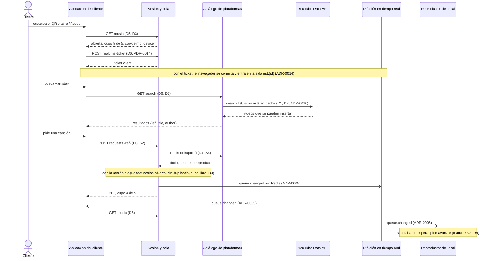
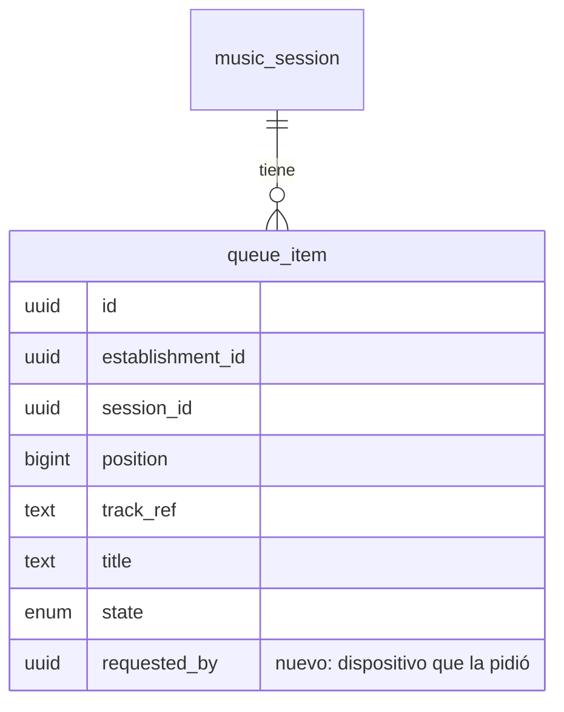
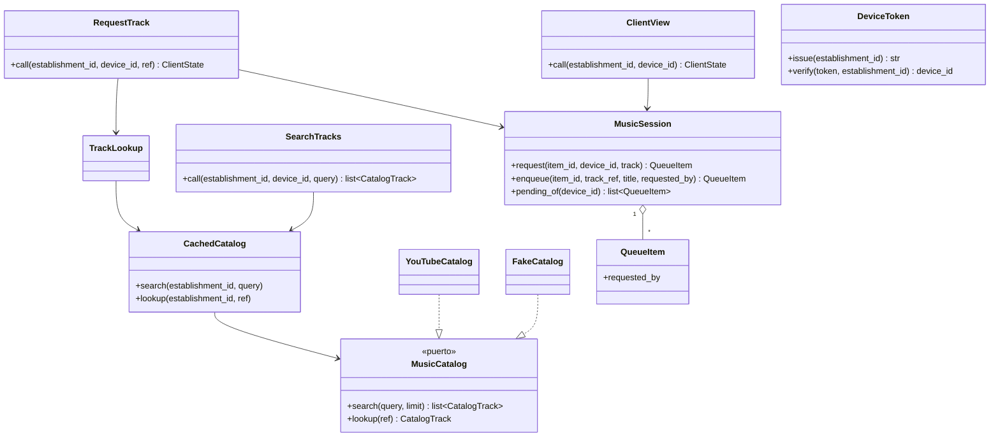

# Plan: Pedir canciones desde el QR

| Campo  | Valor              |
| ------ | ------------------ |
| Spec   | `spec.md`          |
| Fecha  | 2026-10-27         |
| Estado | Approved · dd1145be5931              |

> Este documento describe **cómo**. Si aquí aparece un requisito nuevo que no
> está en `spec.md`, el sitio correcto es `spec.md`, no aquí.
>
> Solo el usuario cambia el Estado, con `/sdd:approve`.

## Resumen

La feature amplía la página del QR (C5) con un buscador y los pedidos del cliente. Crea en el monolito el módulo de catálogo (C3, `src/backend/app/catalog/`), que busca en YouTube tras un adaptador, y añade a la sesión y cola (C2) la regla del pedido: cupo de 5 pendientes por dispositivo y sin duplicadas pendientes. Hay tres decisiones clave:

- **El cliente es un dispositivo anónimo con una cookie firmada por establecimiento** (ADR-0007). Lleva un identificador aleatorio y el establecimiento. Su ruta la limita a las rutas públicas de ese establecimiento, así que no viaja a las de otro. El cupo se cuenta con ese identificador sobre la cola de PostgreSQL, sin guardar nada más del cliente.
- **C2 no confía en lo que manda el navegador:** el pedido trae solo la referencia de la canción, y C2 pide a C3 su título y si se puede reproducir (S4). La regla del cupo y la de las duplicadas se aplican en la misma transacción con la sesión bloqueada que ya usa la cola (feature 002, D2).
- **El cliente recibe los cambios por la misma sala de tiempo real que el panel,** con un ticket de tipo `client` (ADR-0014). Los eventos no llevan datos del cliente, y cada cliente vuelve a pedir su propio estado al recibirlos.

## Comprobación de constitución

| Regla | ¿Se cumple? | Cómo, o excepción justificada |
| ----- | ----------- | ----------------------------- |
| P1 — La spec es la fuente de verdad | sí | El plan cubre R001–R013 y no añade requisitos. |
| P2 — Todo MUST con tarea, prueba y criterios | sí | La estrategia de pruebas cubre cada requisito con pruebas `F003_R0xx`. El trabajo `trace` del CI lo comprueba. |
| P3 — Aislamiento por establecimiento | sí | `queue_item` ya lleva `establishment_id` y RLS. El establecimiento sale del código de la URL y la cookie del dispositivo tiene que ser de ese mismo establecimiento (D3). Las claves de Redis llevan el prefijo `est:{id}` (D2). La batería `test_isolation.py` se amplía con las rutas nuevas. |
| P4 — Datos mínimos | sí | Del cliente solo se guarda un identificador aleatorio del dispositivo en cada canción que pide (D4). No hay nombre, correo, teléfono ni ubicación. El texto de las búsquedas no se guarda en PostgreSQL; solo vive en la caché, con caducidad (D2). |
| P5 — Sin instalación | sí | Es la misma página web del QR (D7). |
| P6 — Solo el propietario controla su cola | sí | El cliente solo añade al final de la cola, por el caso de uso de C2 y con las reglas del cupo. No puede reordenar ni retirar nada (non-goal). |
| P7 — Decisiones transversales como ADR | sí | La identidad anónima (ADR-0007), el ticket `client` (ADR-0014) y la búsqueda con caché (ADR-0010) ya están decididos. El plan no toma ninguna decisión transversal nueva. |
| P8 — Código bajo `src/` | sí | `src/backend/app/catalog/`, `src/backend/app/sessions/`, `src/realtime/` y `src/web/src/features/public-establishment/`. |
| Pruebas de integración contra PostgreSQL real | sí | Las de las rutas públicas y del pedido corren con el rol `app_api`. |
| Pruebas e2e con Playwright | sí | El flujo del cliente se prueba contra el compose, con el catálogo falso y el proveedor de reproducción falso (D8). |
| Rendimiento con prueba de carga | sí | Q1 y Q2 se miden con k6 en `src/perf/`, con el catálogo falso (D10). |
| Cobertura con suelo | sí | El código nuevo llega con sus pruebas; el CI no deja bajar de los suelos actuales. |
| Secretos | sí | `DEVICE_TOKEN_SECRET` y `YOUTUBE_API_KEY` llegan por el entorno. En local hay un valor de desarrollo para el primero y el catálogo falso no necesita clave. En producción, el arranque falla sin ellos (D8). |
| Nada sensible en logs | sí | La clave de YouTube no se escribe en los logs ni en las respuestas de error. Tampoco se registra el texto de las búsquedas. |
| Dependencias nuevas justificadas | sí | Ver D9: `httpx2` pasa a ser dependencia de ejecución del backend. |
| Dependencias prohibidas (S7) | sí | La búsqueda usa la YouTube Data API v3 oficial, desde el monolito y con la clave en el servidor. Sin bibliotecas no oficiales ni scraping. |

## Comprobación de arquitectura

| Decisión o estándar | Cómo lo cumple este plan |
| ------------------- | ------------------------ |
| ADR-0001 — Monolito modular más un servicio de tiempo real | El catálogo (C3) es un módulo nuevo del monolito. El tiempo real sigue en C6, que solo admite un tipo de ticket más. |
| ADR-0002 — Python/FastAPI y TypeScript | C2 y C3 en FastAPI. C5 en la SPA. C6 en Node. |
| ADR-0003 — Una sola SPA | La aplicación del cliente es la página `/l/:code` de la misma SPA (D7). |
| ADR-0004 — PostgreSQL y Redis | La cola y los pedidos viven en PostgreSQL. Redis guarda la caché de búsquedas y el contador de búsquedas por minuto, que son efímeros (D2). |
| ADR-0005 — Socket.IO y pub/sub en Redis | Los cambios de la cola llegan al cliente por la sala `est:{id}`. Las acciones van por la API (D6). |
| ADR-0007 — Token anónimo del cliente | La cookie del dispositivo es el identificador aleatorio firmado por el servidor y ligado al establecimiento (D3). |
| ADR-0009 — Aislamiento con columna y RLS | La columna nueva de `queue_item` hereda su RLS. La consulta del cupo y la de las duplicadas corren en la transacción con el establecimiento fijado. |
| ADR-0010 — YouTube como única plataforma del piloto | C3 usa la YouTube Data API v3 desde el monolito, con caché en Redis y detrás del puerto `MusicCatalog` (D1). La referencia `yt:<id>` es la misma que entiende el adaptador del reproductor (feature 002, D5). |
| ADR-0013 — Código bajo `src/` | Ver P8. |
| ADR-0014 — Ticket de tiempo real | Se añade el tipo `client`, que pide la ruta pública del establecimiento con la cookie del dispositivo (D6). |
| S1 — Capas | `catalog/` y `sessions/` siguen `api/`, `application/`, `domain/` e `infrastructure/`. El adaptador de YouTube vive en `catalog/infrastructure/`. |
| S2 — Solo C2 modifica la cola | El pedido entra por el caso de uso `RequestTrack` de C2 (D4). |
| S4 — C2 obtiene canciones solo a través de C3 | `RequestTrack` valida la referencia con la interfaz de C3 (`TrackLookup`). C2 no llama a YouTube ni interpreta `yt:` (D4). |
| S5 — La difusión solo escucha | C6 no cambia: reenvía los mismos eventos. Solo acepta el tipo de ticket `client`. |
| S6 — Los frontales no acceden a almacenes ni a las APIs de plataformas | La página del cliente busca con la API del monolito, nunca con la de YouTube (D5). |
| S7 — Sin bibliotecas no oficiales | Ver la comprobación de constitución. |
| S8 — `establishment_id`, RLS y prefijos | Las claves de Redis llevan el prefijo `est:{id}`, también la caché de búsquedas (D2). |
| S9 — Sin datos personales de clientes | Ver P4. |
| S10 — Redis nunca es la única copia | El cupo se calcula siempre desde la cola en PostgreSQL. Redis solo guarda la caché y el contador por minuto, que se pueden perder sin efecto en el negocio (D2). |

## Decisiones

### D1 — Módulo de catálogo (C3) con un puerto y dos adaptadores

- **Contexto:** el cliente busca por nombre, artista o álbum (R003). Solo debe ver canciones que se pueden reproducir en el local (R004). Si el proveedor falla, hay que avisar sin tocar la cola (R012). C2 valida cada pedido con C3 (S4).
- **Decisión:**
  - **Módulo nuevo:** `src/backend/app/catalog/`. Su interfaz pública (`app/catalog/interface.py`) tiene:
    - `SearchTracks(establishment_id, device_id, query) -> list[CatalogTrack]`, para la API pública. Recibe el dispositivo para aplicar el límite de R013 (D2);
    - `TrackLookup(establishment_id, ref) -> CatalogTrack | None`, para C2.

    `CatalogTrack` es `{ref, title, author}`. `ref` es la referencia opaca que se guarda en la cola.
  - **Puerto `MusicCatalog`**, en el dominio, con `search(query, limit)` y `lookup(ref)`. Lanza `CatalogUnavailable` si el proveedor no responde, responde con error o se quedó sin cuota.
  - **Adaptador de YouTube** (`YouTubeCatalog`):
    - `search` usa `search.list` con `type=video`, `videoEmbeddable=true`, `part=snippet` y `maxResults=10`. El filtro de inserción cubre R004.
    - `lookup` usa `videos.list` con `part=snippet,status` y comprueba `status.embeddable`. Una canción que no se puede insertar, o que no existe, da `None`.
    - Normaliza el título y el canal (`snippet.title` y `snippet.channelTitle`, que vienen con entidades HTML) y forma la referencia `yt:<videoId>`, el mismo formato que entiende el adaptador del reproductor (feature 002, D5).
    - Cada llamada espera como mucho 1,5 s, dentro de los 2 s de Q1.
  - **Adaptador falso** (`FakeCatalog`), para desarrollo, e2e y carga. Devuelve resultados deterministas con referencias `fake:…` que entiende el proveedor de reproducción falso:
    - por defecto, cinco canciones `«<texto> 1»`…`«<texto> 5»` con `fake:3s`;
    - con el texto `error`, una que falla al sonar (`fake:error`);
    - con el texto `caído`, `CatalogUnavailable`, para R012;
    - con el texto `nada`, ningún resultado.

    No se puede usar con `ENV=production`.
  - **Texto de búsqueda:** se recortan los espacios. Vacío o de más de 100 caracteres, la API responde `422`.
- **Alternativas descartadas:**
  - **La biblioteca oficial `google-api-python-client`:** es síncrona y pesada para dos llamadas REST. Habría que ejecutarla en hilos aparte.
  - **Que el navegador busque directamente en YouTube:** la clave quedaría en el frontal, contra S6 y S7.
  - **Filtrar los videos que no se pueden insertar solo al reproducir:** el cliente pediría canciones que luego se saltan. El filtro en la búsqueda y la comprobación en el pedido lo evitan casi siempre; el reproductor sigue saltando las que fallen (feature 002, R007).
- **Consecuencias:** cada búsqueda cuesta 100 unidades de cuota de YouTube y cada consulta de `videos.list`, 1. Sin la ampliación de cuota que prevé ADR-0010, la cuota diaria por defecto (10 000) da unas 100 búsquedas al día sin caché.

### D2 — Caché de búsquedas y límite por dispositivo en Redis

- **Contexto:** la cuota de YouTube es escasa (D1). Q1 pide resultados en menos de 2 s con la carga de Q2. Un dispositivo no puede gastar la capacidad de todos (R013).
- **Decisión:**
  - **Caché de búsquedas:**
    - Va en la clave `est:{establishment_id}:catalog:search:<sha256 del texto normalizado>`, con los resultados en JSON y una caducidad de 24 h.
    - El texto se normaliza a minúsculas, sin tildes y con los espacios colapsados.
    - Cada resultado se guarda también en `est:{id}:catalog:track:<ref>`, con la misma caducidad. Así `TrackLookup` no gasta cuota cuando el cliente pide una canción que acaba de ver.
  - **Límite por dispositivo (R013):**
    - Un contador `est:{id}:search-rate:{device_id}` con `INCR` y una caducidad de 60 s desde la primera búsqueda.
    - Con más de 10 búsquedas, se responde `429 too_many_searches` con la cabecera `Retry-After`.
    - Una búsqueda servida desde la caché también cuenta.
  - **Si Redis no responde:** la búsqueda va directa al proveedor y el límite no se aplica. Ninguno de los dos es un dato de negocio, y la búsqueda no se rompe por la caché. El fallo queda en el log.
- **Alternativas descartadas:**
  - **Una caché global, compartida entre establecimientos:** ahorraría más cuota, porque muchos locales buscan lo mismo. Pero S8 exige el prefijo de establecimiento en toda clave de Redis. Si la cuota no da, se propone cambiar S8 para la caché del catálogo, que no guarda datos de ningún establecimiento.
  - **El límite en PostgreSQL, como los intentos de inicio de sesión:** cada búsqueda escribiría en la base, lo que no tiene sentido para un contador de un minuto.
- **Consecuencias:** la caché se calienta por establecimiento, así que la cuota que se ahorra depende de cuánto se repitan las búsquedas en cada local. Se medirá en el piloto.

### D3 — Identidad anónima del dispositivo: una cookie firmada por establecimiento

- **Contexto:** el cupo es por dispositivo, sin datos personales (R002, Q7). Un dispositivo de un establecimiento no puede actuar en otro (R011). ADR-0007 fija un identificador aleatorio firmado y ligado al establecimiento.
- **Decisión:**
  - **El token:**
    - `base64url(JSON {est, dev, iat})` + `.` + `base64url(HMAC-SHA256(DEVICE_TOKEN_SECRET, segmento))`, como el ticket de tiempo real.
    - `dev` es un UUID aleatorio.
    - El secreto solo lo conoce el monolito.
  - **La cookie:**
    - se llama `mp_device`, con `HttpOnly`, `Secure` y `SameSite=Lax`;
    - dura un año;
    - su `Path` es `/api/public/establishments/{code}/`, así que el navegador solo la envía a las rutas de ese establecimiento y un mismo móvil tiene una cookie distinta en cada local.
  - **Cuándo se emite:** `GET …/music` la emite si falta o no es válida. Las demás rutas del cliente la exigen.
  - **Validación:** se comprueba la firma y que `est` sea el establecimiento del código de la URL. Si no lo es, la cookie no vale para esa ruta (R011). `GET …/music` emite una nueva, así que el cliente es un dispositivo nuevo en ese establecimiento, y las demás rutas responden `401 device_required`.
  - **Dónde vive:** en `src/backend/app/shared/device_token.py`, junto a `realtime_ticket.py`.
- **Alternativas descartadas:**
  - **Guardar el identificador en `localStorage`** y enviarlo en una cabecera: lo podría leer cualquier script de la página, y mandarlo en cada petición es más trabajo para la SPA que dejar que viaje la cookie.
  - **Una tabla de dispositivos en PostgreSQL:** no aporta nada. El identificador firmado basta para contar el cupo, y no hay nada que revocar.
  - **Huella del navegador** (fingerprinting): es un dato personal según la Ley 1581 y es poco fiable.
- **Consecuencias:**
  - Borrar las cookies, el modo privado o cambiar de navegador da un dispositivo nuevo. Lo acepta el supuesto de la spec y ADR-0007.
  - Como la cookie lleva `Secure`, en local con http Safari no la guarda. Es lo mismo que pasa con la sesión del propietario (`docs/qa/reproductor-youtube.md`).
  - `DEVICE_TOKEN_SECRET` es un secreto nuevo: cambiarlo da un dispositivo nuevo, con su cupo completo, a todos los clientes.

### D4 — El pedido en C2: cupo y duplicadas en el dominio

- **Contexto:** la canción va al final de la cola (R005). El cupo es de 5 pendientes por dispositivo (R006) y se recupera cuando una de ellas empieza a sonar, se salta o se descarta (R007). Con la sesión cerrada no se pide (R008), y una canción pendiente no se repite (R009). La cola solo la cambia C2 (S2), con las reglas en transacción (ADR-0004).
- **Decisión:**
  - **Modelo:** `queue_item` gana `requested_by uuid NULL`, el identificador del dispositivo que la pidió. Es `NULL` para las canciones de la herramienta de desarrollo y, más adelante, del propietario (B05).
  - **Dominio:** `MusicSession.request(item_id, device_id, track)`, con `QUOTA = 5` como constante (B10 la hará configurable por plan). Lanza:
    - `NoOpenSession` (R008);
    - `AlreadyQueued`, si hay una canción `pending` con la misma `track_ref`, la pidiera quien la pidiera (R009);
    - `QuotaExceeded`, si el dispositivo tiene 5 canciones en `pending` (R006).

    Si pasa, llama a `enqueue` con `requested_by`, que la pone al final y publica `queue.changed`.
  - **El cupo se cuenta, no se guarda:** son las canciones en `pending` con ese `requested_by`. Cuando una pasa a `playing`, `skipped` o `discarded` deja de contar sola (R007), sin ningún contador que mantener.
  - **Caso de uso `RequestTrack(establishment_id, device_id, ref)`:**
    1. Obtiene el título con `TrackLookup` de C3, fuera de la transacción. Si da `None`, porque la canción ya no existe o no se puede reproducir, lanza `UnknownTrack` sin tocar la cola ni el cupo (R014).
    2. Con la sesión bloqueada, aplica `request`.
    3. Publica `queue.changed` tras el commit, como `EnqueueTrack`.
  - **Consulta del cliente, `ClientView(establishment_id, device_id)`:** devuelve el estado de la sesión, la canción que suena (solo el título), las pendientes del dispositivo en orden y el cupo libre.
- **Alternativas descartadas:**
  - **Confiar en el título y la referencia que manda el navegador:** un cliente podría poner cualquier título en el panel del propietario, o una referencia que no se puede reproducir. Contra S4.
  - **Un contador de cupo en Redis:** sería la única copia de una regla de negocio, contra S10, y se desincronizaría con los saltos y los cierres.
  - **Un índice único parcial sobre `(session_id, track_ref)` en `pending`:** blindaría las duplicadas, pero también las prohibiría para el propietario en B05, que la spec no decide. La regla vive en `request` y el bloqueo de la sesión evita la carrera entre dos pedidos.
- **Consecuencias:** la búsqueda de duplicadas y el recuento del cupo recorren las canciones pendientes de la sesión, que ya se cargan con la sesión bloqueada. Un índice parcial `(session_id, requested_by) WHERE state = 'pending'` acelera el recuento de `ClientView`.

### D5 — Rutas públicas del cliente

- **Contexto:** C5 busca, pide y ve su estado por la API del monolito (S6). Las rutas no piden la sesión del propietario. El establecimiento sale del código del QR.
- **Decisión:**
  - **Prefijo:** `/api/public/establishments/{code}/`. Es el que limita la cookie (D3).
  - **Establecimiento:** se resuelve con `EstablishmentByPublicCode` de C1. Un código que no existe da `404 not_found` sin más detalle (feature 001, R013).
  - **Rutas:** las que fija la tabla de Contratos: el estado, la búsqueda, el pedido y el ticket de tiempo real.
  - **CSRF:** las peticiones POST exigen la cabecera `X-MyPlaylist-Client`, como el resto de la API (constitución).
  - **Errores:** todos con `{error: "<código>"}`. La SPA traduce cada código al aviso que piden R006, R008, R009, R012 y R013.
- **Alternativas descartadas:**
  - **Rutas `/api/client/*` con el establecimiento solo en la cookie:** se pierde el límite natural del `Path` por establecimiento, y la cookie de un local viajaría a las rutas de todos.
- **Consecuencias:** las rutas públicas quedan expuestas a cualquiera con el código del QR, que es público. El abuso se acota con el cupo (R006), el límite de búsquedas (R013) y la caché (D2).

### D6 — Tiempo real para el cliente

- **Contexto:** el cliente ve, sin recargar, lo que suena, sus pendientes y su cupo (R010), en menos de 1 s (Q4). ADR-0014 prevé el tipo de ticket `client`.
- **Decisión:**
  - **Ticket:** `POST …/realtime-ticket` emite un ticket `client` con el establecimiento de la cookie. El monolito (`TicketRole`) y C6 (`ticket.ts`) aceptan el tipo nuevo, y C6 une el socket a la misma sala `est:{id}`.
  - **Eventos:** no cambian. Ya llevan solo lo que se muestra en pantalla (feature 002, D6).
  - **Qué hace el cliente con ellos:** al recibir `queue.changed`, `track.started`, `track.failed`, `session.opened` o `session.closed`, vuelve a pedir su estado (`GET …/music`), porque sus pendientes y su cupo no viajan en los eventos.
  - **Salto de versión:** la resincronización por salto de versión del cliente de tiempo real (feature 002, D3 y D6) pide también ese estado.
- **Alternativas descartadas:**
  - **Una sala por dispositivo, con eventos personales:** C6 tendría que saber de dispositivos, y el monolito publicaría un evento por cliente afectado en cada cambio.
  - **Poner las pendientes de cada dispositivo en los eventos:** se difundirían a todos los de la sala los pedidos de cada uno.
- **Consecuencias:** cada cambio de la cola provoca un `GET …/music` por cliente conectado del establecimiento, unos 100 con la carga de Q2. Es una consulta de lectura sin bloqueo. La prueba de carga lo mide (D10), y si hace falta, se reparte en el tiempo con un retraso aleatorio de hasta 300 ms, dentro del segundo de Q4.

### D7 — La aplicación del cliente en `/l/:code`

- **Contexto:** la página del QR ya existe (feature 001) y es la entrada de C5. Ahora busca, pide y muestra el estado del cliente (R001, R003, R005, R010).
- **Decisión:**
  - **Pantalla:** la de `src/web/src/features/public-establishment/` gana tres piezas:
    - `useClientMusic`: el estado del cliente, sus acciones y la suscripción a la sala;
    - `SongSearch`: el buscador y sus resultados, cada uno con su botón «Pedir»;
    - `MyRequests`: lo que suena, las pendientes propias y «Te quedan N de 5».
  - **Avisos:** cada código de error de la API tiene su texto: sesión cerrada, cupo lleno, ya está en la cola, búsqueda no disponible y demasiadas búsquedas.
  - **Cliente de tiempo real:** `src/web/src/realtime/client.ts` hoy pide el ticket y el estado a rutas del propietario. Se generaliza con dos funciones que recibe al crearse: `requestTicket` y `fetchState`. El panel y el reproductor pasan las de siempre y el cliente pasa las suyas. La lógica de versiones y reconexión no cambia.
  - **Experiencia:** la página es para móvil y no pide nada antes de dejar buscar. El buscador espera a que el cliente pulse «Buscar», sin buscar mientras escribe, para no gastar cuota ni el límite de R013.
- **Alternativas descartadas:**
  - **Buscar mientras se escribe:** gasta una búsqueda por tecla y agota el límite de R013 en un minuto.
  - **Un segundo cliente de tiempo real solo para C5:** duplicaría la reconexión y la detección de saltos de versión, que ya están probadas.
- **Consecuencias:** cambiar `client.ts` toca el panel y el reproductor. Sus pruebas actuales lo cubren.

### D8 — Configuración, secretos y entorno local

- **Contexto:** la búsqueda real necesita una clave de YouTube, y las pruebas no deben depender de YouTube ni de su cuota (como el reproductor en la feature 002, D5).
- **Decisión:**
  - **Configuración nueva:**
    - `CATALOG_PROVIDER` (`youtube` o `fake`): `fake` en local y en pruebas, `youtube` en producción;
    - `YOUTUBE_API_KEY`;
    - `DEVICE_TOKEN_SECRET`, con un valor de desarrollo como el de `REALTIME_TICKET_SECRET`.
  - **En producción, el arranque falla:** sin `YOUTUBE_API_KEY`, con `CATALOG_PROVIDER=fake` o con el secreto de desarrollo.
  - **Compose:** el servicio `api` lleva `CATALOG_PROVIDER: ${CATALOG_PROVIDER:-fake}` y `YOUTUBE_API_KEY: ${YOUTUBE_API_KEY:-}`, para que el propietario pueda probar con YouTube real en local si tiene una clave. `src/.env.example` documenta las tres variables.
- **Alternativas descartadas:**
  - **Grabar respuestas reales de YouTube y reproducirlas en el e2e:** caducan y no dejan probar R012 a voluntad.
- **Consecuencias:** las pruebas del adaptador de YouTube usan respuestas de ejemplo con `httpx2.MockTransport`, sin red. La búsqueda real solo se prueba a mano, con la prueba manual del reproductor.

### D9 — Dependencias nuevas

- **Contexto:** la constitución exige justificar cada dependencia nueva.
- **Decisión:** `httpx2`, que ya es dependencia de desarrollo (cliente de pruebas de la API), pasa a dependencia de ejecución para llamar a la YouTube Data API. Es asíncrono y trae `MockTransport` para probar el adaptador sin red.
- **Alternativas descartadas:**
  - **`google-api-python-client`:** ver D1.
  - **`aiohttp`:** sería una segunda biblioteca HTTP en el proyecto, que ya usa `httpx2`.
- **Consecuencias:** `pyproject.toml` y `uv.lock` cambian en la misma feature.

### D10 — Prueba de carga de la búsqueda y los pedidos

- **Contexto:** Q1 pide resultados en menos de 2 s con la carga de Q2 (5000 clientes en 50 establecimientos). La constitución exige verificar un requisito no funcional de rendimiento con una prueba de carga en `src/perf/`.
- **Decisión:** `src/perf/client.js` con k6 contra el compose, con el catálogo falso. Cada usuario virtual hace el recorrido completo:
  1. abre la página;
  2. busca, a veces repitiendo búsquedas;
  3. pide hasta llenar su cupo;
  4. consulta su estado.

  Se reparten 50 establecimientos con su sesión abierta. Los umbrales son el p95 de la búsqueda por debajo de 2 s y 0 errores 5xx. El resultado queda anotado en el propio script.
- **Alternativas descartadas:**
  - **Medir contra YouTube real:** gastaría la cuota del día en una sola ejecución.
- **Consecuencias:** la prueba mide el monolito, la caché y la base, no la latencia de YouTube. La de YouTube queda acotada por la espera de 1,5 s del adaptador (D1).

## Componentes afectados

| Componente | Cambio | Requisitos que cubre |
| ---------- | ------ | -------------------- |
| `src/backend/app/catalog/` | Módulo nuevo (C3): puerto `MusicCatalog`, adaptadores `YouTubeCatalog` y `FakeCatalog`, caché y límite en Redis, `SearchTracks` y `TrackLookup` | R003, R004, R012, R013 |
| `src/backend/app/sessions/domain/` | `MusicSession.request` con cupo y duplicadas; `requested_by` en `QueueItem` | R005, R006, R007, R008, R009 |
| `src/backend/app/sessions/application/` | Casos de uso `RequestTrack` y `ClientView` | R005, R006, R007, R008, R009, R010, R014 |
| `src/backend/app/sessions/api/client.py` | Rutas públicas del cliente bajo `/api/public/establishments/{code}/`; resuelven el código con C1, buscan con C3 y piden y consultan con C2 | R001, R002, R003, R005, R006, R008, R009, R010, R011, R012, R013, R014 |
| `src/backend/app/shared/device_token.py` | Emisión y validación de la cookie del dispositivo | R002, R011 |
| `src/backend/app/shared/realtime_ticket.py`, `src/realtime/src/ticket.ts` | Tipo de ticket `client` | R010 |
| `src/backend/migrations/versions/0003_queue_requests.py` | `queue_item.requested_by` y su índice parcial | R002, R006, R007 |
| `src/web/src/features/public-establishment/` | Buscador, pedidos, estado del cliente y avisos | R001, R003, R005, R006, R008, R009, R010, R012, R013, R014 |
| `src/web/src/realtime/client.ts` | `requestTicket` y `fetchState` inyectables | R010 |
| `src/perf/client.js` | Carga de la búsqueda y los pedidos | R003, R005 |
| `src/docker-compose.yml`, `src/.env.example`, `app/shared/config.py` | `CATALOG_PROVIDER`, `YOUTUBE_API_KEY`, `DEVICE_TOKEN_SECRET` | R003, R012 |

## Modelo de datos

- **`queue_item`:** columna nueva `requested_by uuid NULL`.
  - Índice parcial `(session_id, requested_by) WHERE state = 'pending'`.
  - Hereda la política RLS de la tabla y los permisos de `app_api`.
- **Migración:** `0003_queue_requests`, reversible.
- **Redis** (no es fuente de verdad, S10):
  - `est:{id}:catalog:search:<hash>` y `est:{id}:catalog:track:<ref>`, con caducidad de 24 h;
  - `est:{id}:search-rate:{device}`, con caducidad de 60 s.
- **No se guarda** el texto de las búsquedas en PostgreSQL ni ningún otro dato del cliente.

## Contratos

Todos los cuerpos van en JSON. Las rutas no piden la sesión del propietario; las que modifican algo exigen la cabecera `X-MyPlaylist-Client`. Un código de establecimiento que no existe da `404 not_found` en todas.

| Método y ruta | Entrada | Respuestas |
| ------------- | ------- | ---------- |
| `GET /api/public/establishments/{code}/music` | cookie `mp_device` (opcional) | `200 {status: "open" \| "closed", now_playing: {title} \| null, mine: [{item_id, title}], quota: {limit: 5, free}}`. Emite la cookie si falta o no vale (R002, R008, R010). |
| `GET /api/public/establishments/{code}/search?q=…` | cookie `mp_device` | `200 {results: [{ref, title, author}]}` (R003, R004) · `409 no_open_session` (R008) · `429 too_many_searches` con `Retry-After` (R013) · `503 search_unavailable` (R012) · `401 device_required` · `422` |
| `POST /api/public/establishments/{code}/requests` | `{ref}` y cookie `mp_device` | `201 {mine, quota}` (R005) · `409 no_open_session` (R008) · `409 quota_exceeded` (R006) · `409 already_queued` (R009) · `422 unknown_track` (la canción ya no existe o no se puede reproducir, R014) · `503 search_unavailable` (R012) · `401 device_required` (R011) |
| `POST /api/public/establishments/{code}/realtime-ticket` | cookie `mp_device` | `200 {ticket, expires_in: 60}` con `Cache-Control: no-store` y tipo `client` (R010) · `401 device_required` |

**Interfaz de C3 para otros módulos** (`app/catalog/interface.py`):
- `SearchTracks(establishment_id, device_id, query) -> list[CatalogTrack]`;
- `TrackLookup(establishment_id, ref) -> CatalogTrack | None`.

Las dos lanzan `CatalogUnavailable`, y `SearchTracks` también `SearchRateExceeded`.

**Interfaz de C2** (`app/sessions/interface.py`), que se amplía:
- `RequestTrack(establishment_id, device_id, ref) -> ClientState`;
- `ClientView(establishment_id, device_id) -> ClientState`.

`RequestTrack` lanza `NoOpenSession`, `QuotaExceeded`, `AlreadyQueued` o `UnknownTrack`.

**Ticket de tiempo real:** el campo `role` admite `client` (ADR-0014). Los eventos no cambian.

## Diagramas

### Secuencia

### Modelo de datos

### Clases

## Estrategia de pruebas

| Requisito | Tipo de prueba | Dónde vive |
| --------- | -------------- | ---------- |
| R001 | integración (`GET music` con la sesión abierta, sin sesión iniciada: `200 open`), componente (la página muestra el buscador) y e2e (desde la URL del QR se busca y se pide) | `src/backend/tests/integration/test_client_music.py`, `src/web/src/features/public-establishment/PublicEstablishment.test.tsx`, `src/web/e2e/client.spec.ts` |
| R002 | unitaria (el token del dispositivo se firma, se verifica y se rechaza alterado o de otro establecimiento), integración (la cookie se emite con `Path` del establecimiento, `HttpOnly` y `Secure`; con la misma cookie se ven las mismas pendientes; `queue_item` solo guarda `requested_by`) | `src/backend/tests/unit/test_device_token.py`, `test_client_music.py` |
| R003 | unitaria (el adaptador de YouTube normaliza título y canal y forma `yt:<id>`, con `MockTransport`), integración (`GET search` con el catálogo falso) y componente (resultados con título y autor; sin resultados) | `src/backend/tests/unit/test_youtube_catalog.py`, `test_client_music.py`, `PublicEstablishment.test.tsx` |
| R004 | unitaria (la búsqueda pide `videoEmbeddable=true`; `lookup` da `None` si `status.embeddable` es falso) | `test_youtube_catalog.py` |
| R005 | unitaria (`request` pone la canción al final con `requested_by`), integración (`POST requests` da `201`, la cola cambia, se publica `queue.changed` y se devuelve el cupo) y e2e (la canción pedida suena en el reproductor en espera) | `src/backend/tests/unit/test_music_session_rules.py`, `test_client_music.py`, `client.spec.ts` |
| R006 | unitaria (con 5 pendientes, `QuotaExceeded`; otro dispositivo sí puede), integración (`409 quota_exceeded` y la cola intacta) y componente (aviso de cupo lleno) | `test_music_session_rules.py`, `test_client_music.py`, `PublicEstablishment.test.tsx` |
| R007 | unitaria (una canción en `playing`, `skipped` o `discarded` no cuenta) e integración (tras `started`, tras `failed` y tras cerrar y abrir, el cupo vuelve) | `test_music_session_rules.py`, `test_client_music.py` |
| R008 | integración (`GET music` con la sesión cerrada: `closed`; `POST requests` y `GET search`: `409 no_open_session`) y componente (aviso sin buscador) | `test_client_music.py`, `PublicEstablishment.test.tsx` |
| R009 | unitaria (`AlreadyQueued` si está pendiente; una que ya sonó se acepta) e integración (`409 already_queued` sin gastar cupo) | `test_music_session_rules.py`, `test_client_music.py` |
| R010 | servicio de tiempo real (C6 acepta el ticket `client` y lo une a su sala), componente (al llegar `queue.changed`, la página pide su estado y lo muestra) y e2e (al empezar a sonar su canción, el cliente ve el cupo recuperado sin recargar) | `src/realtime/test/rooms.test.ts`, `PublicEstablishment.test.tsx`, `client.spec.ts` |
| R011 | integración en la batería de aislamiento (la cookie de A no vale en las rutas de B: en B es un dispositivo nuevo; un pedido con la cookie de A no cambia la cola de A ni la de B; nadie ve los pedidos de otro dispositivo) y servicio de tiempo real (un ticket `client` de A no se une a la sala de B) | `src/backend/tests/integration/test_isolation.py`, `src/realtime/test/rooms.test.ts` |
| R012 | unitaria (el adaptador lanza `CatalogUnavailable` ante un 5xx, un 403 de cuota o una espera agotada), integración (`503 search_unavailable` con el catálogo falso, sin cambiar la cola) y componente (aviso) | `test_youtube_catalog.py`, `test_client_music.py`, `PublicEstablishment.test.tsx` |
| R013 | integración (la búsqueda 11 en un minuto da `429` con `Retry-After`; sin Redis, la búsqueda sigue) | `test_client_music.py` |
| R014 | integración (`RequestTrack` con una referencia que el catálogo ya no reconoce lanza `UnknownTrack`; `POST requests` da `422 unknown_track` sin cambiar la cola ni el cupo) y componente (aviso de canción no disponible) | `src/backend/tests/integration/test_request_track.py`, `test_client_music.py`, `PublicEstablishment.test.tsx` |

**Requisitos no funcionales:**
- **Q1 y Q2:** `src/perf/client.js`, con k6 y el catálogo falso (D10).
- **Q4:** el e2e mide desde que empieza a sonar la canción del cliente hasta que ve su cupo recuperado, sin recargar.
- **Q6:** se mide en R011.
- **Q7:** se mide en R002, revisando las columnas guardadas.
- **Q8:** el e2e corre en Chromium móvil.

## Riesgos técnicos

| Riesgo | Impacto | Mitigación |
| ------ | ------- | ---------- |
| La cuota de YouTube por defecto (10 000 unidades al día, unas 100 búsquedas) se agota en el piloto | Las búsquedas responden `503` y nadie puede pedir (R012) | Caché por establecimiento (D2), límite por dispositivo (R013) y la solicitud de ampliación de cuota que prevé ADR-0010. Si no basta, proponer una caché global (cambio de S8). |
| La latencia de YouTube supera los 2 s de Q1 | Búsquedas lentas | Espera máxima de 1,5 s en el adaptador; los resultados repetidos salen de la caché. |
| Cada cambio de la cola provoca un `GET music` por cliente conectado | Picos de lectura en la API | Es una consulta de lectura sin bloqueo; se mide con D10, y si hace falta se reparte con un retraso aleatorio. |
| Safari no guarda cookies `Secure` por http en local | El cliente en Safari no tiene dispositivo en local | Igual que la sesión del propietario: en HTTPS funciona. Se prueba en un entorno HTTPS. |

## Trazabilidad

Todos los requisitos MUST de `spec.md` (R001–R003, R005–R012 y R014) aparecen en la tabla de componentes y en la de pruebas. Los SHOULD R004 y R013 también están cubiertos. El plan no introduce ningún requisito.

La enmienda de la spec del 2026-10-27, tras `/sdd:analyze`, se cubre así:
- **R011 aclarado:** D3 ya trataba la cookie de otro establecimiento como un dispositivo nuevo; la estrategia de pruebas recoge los criterios nuevos.
- **R014 nuevo:** `UnknownTrack` y `422 unknown_track` (D4, Contratos).

La misma pasada corrige la firma de `SearchTracks`, que recibe el dispositivo para el límite de R013, y alinea la medida de Q4 con el e2e.

La pregunta abierta de la spec, si el límite de R013 sigue en 10 búsquedas por minuto, no afecta al diseño: el límite es una constante del catálogo y se ajusta tras medir el piloto.
