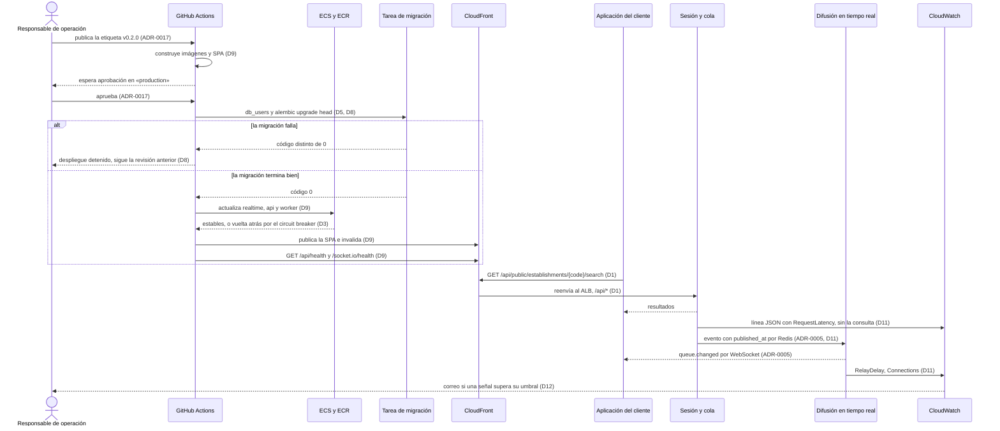
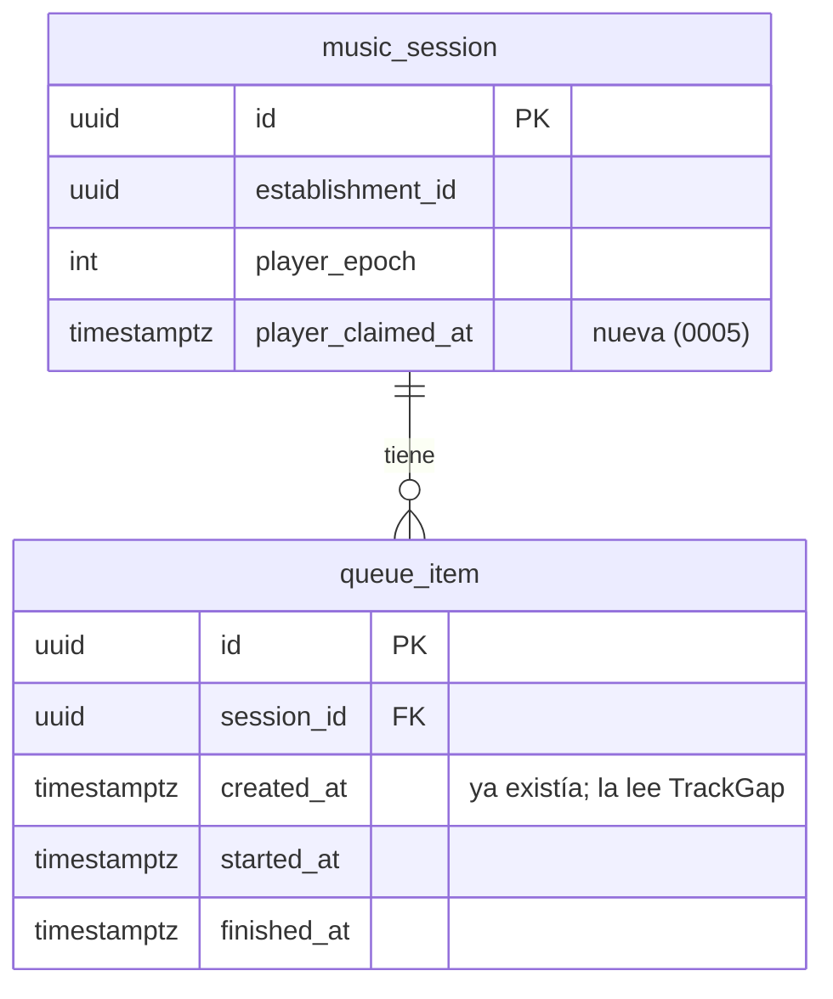
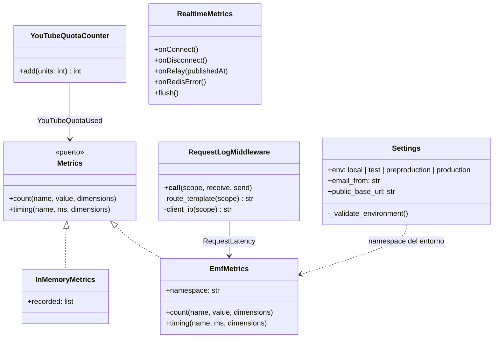

# Plan: Infraestructura y puesta en marcha en AWS

| Campo  | Valor              |
| ------ | ------------------ |
| Spec   | `spec.md`          |
| Fecha  | 2026-11-09         |
| Estado | Approved · 1702d7268b22              |

> Este documento describe **cómo**. Si aquí aparece un requisito nuevo que no
> está en `spec.md`, el sitio correcto es `spec.md`, no aquí.
>
> Sustituye todo texto en cursiva; si una sección no aplica, escribe
> «No aplica.». Solo el usuario cambia el Estado, con `/sdd:approve`.

## Resumen

Se construye en AWS el entorno de ADR-0019 (us-east-2, que sustituye a las decisiones anteriores de región y de correo), definido con Terraform en `src/infra/` (ADR-0016). Lo forman CloudFront delante de todo en `myplaylist.200oklabs.com`, ECS Fargate para la API, el trabajador y el tiempo real, RDS PostgreSQL Multi-AZ, ElastiCache Redis y SES.

El despliegue lo hace GitHub Actions desde una etiqueta, con aprobación y OIDC (ADR-0017). La observabilidad va en CloudWatch, con alarmas por correo (ADR-0018).

La aplicación cambia en lo justo para medir las señales y proteger los registros: un registro por petición sin la cadena de consulta, métricas EMF y un modo `preproduction`. La versión que se pone en marcha es la 0.2.0, que incluye todo esto.

La decisión clave es servir la SPA, la API y el tiempo real **bajo el mismo origen**, con CloudFront delante de todo. Así se conservan sin cambios la cookie `SameSite=Lax`, la comprobación de `Origin` y el tiempo real en `window.location.origin` (D9 de 001).

## Comprobación de constitución

| Regla | ¿Se cumple? | Cómo, o excepción justificada |
| ----- | ----------- | ----------------------------- |
| Principio 1: la spec es la fuente de verdad | sí | La contradicción con la etiqueta `v0.1.0` se resolvió aclarando la spec antes de este plan. |
| Principio 2: todo MUST con tarea, prueba y criterios | sí | Hay dos tipos de prueba. **Automáticas:** pytest, Vitest y `terraform test`. **De entorno:** las verificaciones que solo se pueden hacer contra AWS (despliegue, caídas, copias, alertas y retirada). Estas se documentan en `docs/qa/` con el ID `F004_R0xx`, y `.sdd/config.json` añade `docs/qa/*.md` a las pruebas que lee `sdd trace` (D15). |
| Principio 3: aislamiento por establecimiento | sí | No se toca RLS. La API y el trabajador se conectan con usuarios propios, miembros de `app_api` y `app_worker`, sin `BYPASSRLS` ni permisos de migración (D5). |
| Principio 4: datos mínimos y Ley 1581 | sí | Los registros no guardan el texto buscado, cookies, tokens ni contraseñas (D11). Todos los registros se conservan 30 días. La IP solo aparece en los rechazos 401 y 403 (R020). La transferencia a EE. UU. ya la anota ADR-0019. |
| Principio 5: sin instalación | sí | No cambia nada para los usuarios. |
| Principio 7: decisiones transversales como ADR | sí | La herramienta de infraestructura, el camino de despliegue y la observabilidad se proponen como ADR-0016, ADR-0017 y ADR-0018. |
| Principio 8: el código vive bajo `src/` | sí | La infraestructura vive en `src/infra/`. Los flujos van en `.github/workflows/` y las pruebas manuales en `docs/qa/`, como hasta ahora. |
| Dependencias nuevas justificadas | sí | Terraform (ADR-0016) y la imagen de k6 en Fargate para la prueba de carga (D13). En la aplicación no hay dependencias nuevas: el formato EMF se escribe a mano en JSON. |
| Secretos fuera del repositorio | sí | Los secretos viven en Secrets Manager y ECS los inyecta al arrancar cada tarea (D6). OIDC evita guardar claves de AWS en GitHub (ADR-0017). gitleaks sigue en el CI. |
| La API y el trabajador nunca usan `BYPASSRLS` ni permisos de migración | sí | Solo la tarea de migración usa el usuario maestro de RDS. La API y el trabajador se conectan con `myplaylist_api` y `myplaylist_worker`, sin privilegios (D5). |
| `ENV=production` no arranca sin SES ni con la política en borrador | sí | Se refuerza: la API se niega a arrancar si el remitente es de `example.com` o la URL pública no es HTTPS. El modo `preproduction` exige secretos propios, pero admite el catálogo falso y Mailpit (D7). |
| Desplegar a producción exige aprobación humana | sí | El entorno `production` de GitHub exige un revisor (ADR-0017). |
| Merge a `main` por PR con el CI en verde | sí | El CI añade el trabajo `infra`, que agrupa `ci` (D16). |
| Cobertura con suelo | sí | El código nuevo de la aplicación (registro y métricas) lleva pruebas, así que el suelo no baja. |

## Comprobación de arquitectura

| Decisión o estándar | Cómo lo cumple el plan |
| ------------------- | ---------------------- |
| ADR-0001: monolito modular y servicio de tiempo real | Hay dos imágenes: la del monolito, que usan la API y el trabajador, y la del tiempo real. Cada una es un servicio de ECS. |
| ADR-0003: una SPA React con Vite | La SPA se compila con `vite build` y se sirve desde S3 a través de CloudFront (D1). |
| ADR-0004: PostgreSQL y Redis | RDS PostgreSQL 16, la misma versión mayor del compose, y ElastiCache Redis OSS 7.1. Redis 7 o posterior es lo que pide `EXPIRE NX` (D4). |
| ADR-0005: Socket.IO y pub/sub en Redis | El cliente usa solo WebSocket (`transports: ["websocket"]`), así que no hacen falta sesiones pegajosas en el ALB. Cada tarea de C6 se suscribe al canal y entrega a sus propias conexiones (D3). |
| ADR-0019: AWS con contenedores y correo en us-east-2 | Toda la topología está en D1 a D4, en us-east-2. Hay al menos dos tareas por servicio, en dos zonas. El certificado de CloudFront va en us-east-1, con un proveedor de Terraform con alias (D18); el del origen del ALB, en us-east-2 (D1). |
| ADR-0007: autenticación propia | Sin cambios. Las cookies `Secure` ya exigen HTTPS, que da CloudFront (D1). |
| ADR-0009: RLS | Los usuarios de conexión no tienen `BYPASSRLS` (D5). |
| ADR-0010: YouTube | Producción usa YouTube. La alarma de cuota (R021) cuenta las unidades que gasta cada llamada (D11). |
| ADR-0019: correo con SES en us-east-2 | SES en us-east-2, con el dominio verificado, DKIM y un MAIL FROM propio. La aplicación usa us-east-2 por defecto y las tareas lo fijan con `AWS_REGION` (D14). |
| ADR-0013: código bajo `src/` | `src/infra/`. |
| ADR-0014: ticket de tiempo real | `REALTIME_TICKET_SECRET` está en Secrets Manager y es el mismo para la API, el trabajador y C6 (D6). |
| ADR-0015: varios procesos | `API_WORKERS` es igual a las vCPU de la tarea (2). Las conexiones caben en `max_connections` de RDS (D3, D4). |
| ADR-0016: Terraform | `src/infra/`, con un estado por entorno y `terraform test` en el CI. Su consecuencia sobre las contraseñas en el estado no se da: los secretos generados son efímeros y de solo escritura, y solo queda la cabecera de CloudFront (D6). |
| ADR-0017: GitHub Actions con aprobación y OIDC | `deploy.yml`, `preproduction.yml` y `maintenance.yml` (D9, D13, D14). |
| ADR-0018: CloudWatch | Registros JSON con EMF, comprobaciones de salud de Route 53, alarmas con SNS y Contributor Insights (D11, D12). |
| S1: capas | Las métricas de la aplicación pasan por un puerto `Metrics` del dominio compartido, que implementa la infraestructura (D11). |
| S5: la difusión solo escucha | C6 solo añade métricas de lo que reenvía. La API añade `published_at` a los eventos, sin cambiar su significado (D11). |
| S6: los frontales no acceden a los almacenes | Sin cambios: la SPA sigue usando solo la API y el tiempo real, bajo el mismo origen. |
| S8: prefijo de establecimiento en Redis y salas | Sin cambios. El contador de cuota de YouTube es global y no es un dato de negocio: `catalog:youtube-units:{día}` (D11). |
| S10: Redis no es la única copia | El contador de cuota es solo para medir; si se pierde, la alarma se retrasa, sin perder datos de negocio. |

## Decisiones

### D1 — Un único origen con CloudFront delante de todo

- **Contexto:** la SPA, la API y el tiempo real comparten origen en local (D9 de 001). La cookie de sesión es `SameSite=Lax`, la API comprueba `Origin` contra `PUBLIC_BASE_URL`, y la SPA abre Socket.IO contra `window.location.origin`. R003 pide solo HTTPS bajo el dominio.
- **Decisión:**
  - **Dirección:** `myplaylist.200oklabs.com` (la eligió el usuario), con una distribución de CloudFront, certificado de ACM en us-east-1 (CloudFront solo admite los de esa región; el resto del servicio está en us-east-2, ADR-0019) y registros alias en Route 53. Es la dirección que llevan los QR.
  - **Rutas de CloudFront:**
    - `/api/*` va al ALB, al grupo de destino de la API, sin caché y reenviando cookies, cabeceras y la cadena de consulta;
    - `/socket.io/*` va al ALB, al grupo de destino de C6, sin caché y con WebSocket;
    - el resto va al bucket de S3 de la SPA, con Origin Access Control.
  - **Rutas de la SPA:** una sola función de CloudFront en `viewer-request`, `edge`, asociada a los tres comportamientos (D10).
    - En el comportamiento por defecto, reescribe a `/index.html` toda ruta sin extensión (`/l/:code`, `/panel`…).
    - En `/api/*` y `/socket.io/*` no reescribe nada.

    La distribución **no** tiene respuestas de error personalizadas: en CloudFront valen para todos los orígenes, y convertirían en `index.html` con 200 los 404 y 403 de la API, como el `404 not_found` de un establecimiento que no existe (R013 de 001).
  - **HTTPS:** el comportamiento por defecto es `redirect-to-https`, con TLS 1.2 como mínimo (R003).
  - **Acceso al ALB:** es público, pero su grupo de seguridad solo admite la lista de prefijos gestionada de CloudFront, en el puerto 443. Además, el listener exige una cabecera secreta que solo pone CloudFront; sin ella, responde 403.
  - **De CloudFront al ALB, también HTTPS:** el ALB solo escucha en 443, con un certificado de ACM en us-east-2 para un nombre de origen propio, `origin.myplaylist.200oklabs.com`, validado por DNS en la zona y con un registro alias al ALB. CloudFront apunta a ese nombre con `https-only` y TLS 1.2. Así la cabecera secreta, las cookies y los datos no viajan en claro entre CloudFront y el ALB.
  - **El certificado del ALB cubre también el dominio público:** la política de petición al origen reenvía todas las cabeceras del visitante, Host incluida, más `CloudFront-Viewer-Address` (D11). Con Host reenviado, CloudFront comprueba el certificado del origen contra ese nombre, el dominio público. El registro de validación de ese nombre es uno solo, del módulo de borde: ACM usa el mismo CNAME en las dos regiones, y el cómputo lo espera sin crear otro.
  - **Preproducción:** `pre.myplaylist.200oklabs.com` y `origin.pre.myplaylist.200oklabs.com`, con la misma definición.
- **Alternativas descartadas:**
  - Respuestas de error personalizadas (404 → `index.html`): son lo habitual para una SPA en S3, pero afectan también a las respuestas de la API.
  - HTTP entre CloudFront y el ALB: ahorra el certificado del origen, pero la cabecera secreta y las cookies de sesión cruzarían internet en claro.
  - HTTPS contra el nombre `*.elb.amazonaws.com` del ALB: CloudFront exige que el certificado del origen coincida con su nombre, y en ese dominio no se puede emitir uno propio.
  - No reenviar Host, con una lista cerrada de cabeceras: el certificado del ALB solo necesitaría `origin.<dominio>`, pero cada cabecera nueva de la aplicación habría que añadirla a mano, y si se olvida, falla sin avisar.
  - `api.myplaylist…` en un subdominio aparte: rompería el mismo origen, obligaría a CORS con credenciales y a cambiar la cookie y la comprobación de `Origin`.
  - Servir la SPA desde la API: mezcla estáticos y API en las mismas tareas y pierde la caché de CloudFront.
- **Consecuencias:**
  - Todo pasa por CloudFront, incluido el WebSocket.
  - Hay dos certificados por entorno: el del dominio público en us-east-1, para CloudFront, y el del origen en us-east-2, para el ALB, que cubre `origin.<dominio>` y `<dominio>`. Los dos son gratuitos y ACM los renueva solo.
  - CloudFront corta una conexión WebSocket inactiva a los 10 minutos. Socket.IO envía un latido cada 25 s, así que no llega a pasar.
  - Cambiar la dirección obliga a reimprimir los QR.

### D2 — Red sin NAT: tareas en subredes públicas y datos en privadas

- **Contexto:** las tareas necesitan salir a internet: YouTube, SES, Secrets Manager, ECR y CloudWatch. Un NAT Gateway cuesta unos US$32 al mes por zona, más el tráfico. Y con uno solo, se vuelve un punto único de fallo para Q3.
- **Decisión:**
  - Una VPC con dos zonas: subredes públicas para el ALB y las tareas de ECS, y subredes privadas, sin salida a internet, para RDS y ElastiCache.
  - Las tareas tienen IP pública, pero su grupo de seguridad solo admite entradas desde el ALB.
  - RDS y Redis solo admiten conexiones desde los grupos de seguridad de las tareas.
- **Alternativas descartadas:**
  - NAT Gateway en cada zona: unos US$65 al mes, más el tráfico.
  - Un solo NAT: un punto de fallo para Q3.
  - Endpoints de VPC para cada servicio de AWS: unos US$7 al mes por endpoint y zona, más de US$80 por los cinco servicios, y YouTube seguiría necesitando salida.
- **Consecuencias:**
  - Cada IP pública cuesta unos US$3,65 al mes.
  - Si una tarea abriera un puerto por error, el grupo de seguridad sigue siendo la barrera.

### D3 — Servicios de ECS y su capacidad

- **Contexto:** Q2 pide unas 870 peticiones por segundo en la hora pico (Q2 de 003). En local, cuatro procesos daban unas 600 peticiones por segundo con p95 de 95 ms, en un portátil compartido con PostgreSQL y k6 (D11 de 003). Q3 y ADR-0019 piden al menos dos tareas por servicio.
- **Decisión:** un clúster de ECS Fargate (x86_64), con cada servicio repartido en las dos zonas.

  | Servicio | Tarea | Tareas | Mando |
  | -------- | ----- | ------ | ----- |
  | `api` | 2 vCPU, 4 GiB, `API_WORKERS=2` | 2 a 6, autoescalado al 60 % de CPU | `uvicorn … --workers 2 --no-access-log` |
  | `worker` | 0,25 vCPU, 0,5 GiB | 2 fijas | `python -m app.worker` |
  | `realtime` | 0,5 vCPU, 1 GiB | 2 a 4, autoescalado al 60 % de CPU | `sh -c 'export REDIS_URL="rediss://:${REDIS_AUTH_TOKEN}@${REDIS_HOST}:${REDIS_PORT}/0" && exec node dist/server.js'` (D6) |

  - **Comprobaciones de salud del ALB:** `/api/health` y `/health`. Hay que superar dos seguidas cada 10 s para recibir tráfico.
  - **Despliegues:** con el «deployment circuit breaker» y vuelta atrás automática. Si las tareas nuevas no superan su comprobación de salud, ECS vuelve a la revisión anterior (R005).
  - **Las migraciones no corren al arrancar la API,** como hacía el compose: van en una tarea aparte (D8).
  - **El tamaño máximo lo fija la prueba de carga** en la preproducción (R017). Si 6 tareas no bastan, se sube el máximo y se recalculan las conexiones (D4).
- **Alternativas descartadas:**
  - Tareas de 4 vCPU: menos tareas, pero con dos el mínimo ya sería de 8 vCPU, el doble de coste en reposo.
  - Graviton (ARM64): un 20 % más barato, pero exige construir imágenes para ARM y comprobar las dependencias nativas (asyncpg, argon2-cffi). Queda como ahorro posterior.
  - Fargate Spot: puede quitar tareas con 2 minutos de aviso, lo que no casa con Q3.
- **Consecuencias:**
  - En reposo hay 4 vCPU para la API.
  - El autoescalado tarda unos minutos en reaccionar: el arranque de la hora pico lo absorbe el mínimo de dos tareas.

### D4 — Datos: RDS Multi-AZ y ElastiCache con réplica

- **Decisión:**
  - **RDS PostgreSQL 16, `db.t4g.medium` (4 GiB) Multi-AZ:**
    - almacenamiento gp3 de 20 GiB con autoescalado y cifrado;
    - copias automáticas de 7 días y restauración a cualquier momento (pérdida máxima de unos 5 minutos, R010);
    - protección contra borrado e instantánea final al destruirse, solo en producción;
    - el usuario maestro lo gestiona RDS en Secrets Manager.
  - **Conexiones:**
    - la API llega como mucho a 6 tareas × 2 procesos × 15 = 180;
    - el trabajador, a 2 × 15 = 30;
    - la migración, a unas pocas.

    El total, unas 215, queda por debajo del `max_connections` de esa instancia, unas 400. Una alarma avisa al 80 % (SG2).
  - **ElastiCache Redis OSS 7.1, `cache.t4g.small`:** grupo de replicación con una réplica en la otra zona, conmutación automática por error, cifrado en tránsito y en reposo, y token de autenticación. La URL pasa a ser `rediss://…`; redis-py y el cliente de Node la admiten sin cambios.
- **Alternativas descartadas:**
  - Aurora PostgreSQL Serverless v2: escala sola, pero su mínimo de 0,5 ACU en dos zonas cuesta más que una `t4g.medium`, y no hace falta para 50 locales.
  - Una instancia de clase `m7g`: más estable bajo carga sostenida, pero cuesta unas 2,5 veces más. Si la prueba de carga agota los créditos de CPU de la `t4g`, se cambia (riesgo anotado).
  - Valkey en ElastiCache: más barato, pero ADR-0004 dice Redis. Cambiarlo es otra decisión.
- **Consecuencias:**
  - La conmutación de RDS tarda entre 60 y 120 s, y las conexiones del pool se rehacen solas gracias a `pool_pre_ping` (D11 de 003).
  - La de Redis tarda unos segundos, y el reenvío de C6 se vuelve a suscribir.

### D5 — Usuarios de base de datos sin privilegios

- **Contexto:** hoy, en local, la API y las migraciones se conectan con el mismo superusuario, y la aplicación hace `SET LOCAL ROLE app_api`. La constitución prohíbe que la API use permisos de migración.

  La migración `0001` necesita privilegios de administración de roles: crea los roles `app_*` con `CREATE ROLE`, les aplica `ALTER ROLE … NOBYPASSRLS` y hace `GRANT app_migrator TO current_user`. En RDS, el usuario maestro tiene `CREATEROLE` y es miembro de `rds_superuser`, pero no es superusuario.
- **Decisión:**
  - **Las migraciones corren con el usuario maestro de RDS,** que solo usa la tarea de migración (D8). Ningún servicio recibe su secreto.
  - **Los servicios se conectan con dos usuarios con contraseña,** cada una en Secrets Manager:
    - `myplaylist_api`, miembro de `app_api`;
    - `myplaylist_worker`, miembro de `app_worker`.

    Ninguno tiene `BYPASSRLS` ni `CREATEROLE`, ni es miembro de `rds_superuser` ni de `app_migrator`.
  - **Creación:** los crea `app.ops.db_users`, que corre en la tarea de migración después de `alembic upgrade head` y es idempotente. Asigna las contraseñas que lee de Secrets Manager y comprueba esos atributos.
  - **La `0001` en RDS:** con un usuario `CREATEROLE` que no es superusuario, PostgreSQL 16 puede rechazar cambiar el atributo `BYPASSRLS`. La `0001` pasa a aplicar `NOBYPASSRLS` solo a los roles que lo tienen (`pg_roles.rolbypassrls`). Un rol recién creado ya nace sin él, así que en una base nueva no hace falta cambiarlo, y en una que lo tuviera la migración sigue corrigiéndolo. Se prueba en local con un usuario `CREATEROLE` sin superusuario, que imita al maestro de RDS (T008).
  - **Conexión:** `DATABASE_URL` se compone en el arranque con el usuario de cada servicio (D6).
- **Alternativas descartadas:**
  - Que la API use el usuario maestro y confíe en `SET LOCAL ROLE`: el maestro es miembro de `rds_superuser`, y un fallo que se saltara el `SET ROLE` daría acceso total.
  - Autenticación IAM de RDS: evita las contraseñas, pero exige renovar un token cada 15 minutos en el pool de asyncpg, lo que es más código y más riesgo.
  - Un usuario `myplaylist_migrator` para las migraciones: sin `CREATEROLE` no podría correr la `0001` en una base nueva, y con `CREATEROLE` queda igual de privilegiado que el maestro.
- **Consecuencias:**
  - Cambiar una contraseña es cambiar el secreto y volver a correr la tarea de migración.
  - El cambio de la `0001` no altera su resultado en las bases que ya la tienen aplicada (local y CI): Alembic no la vuelve a ejecutar.

### D6 — Secretos y configuración

- **Decisión:**
  - **Los secretos viven en Secrets Manager**, uno por valor y por entorno, con el nombre `myplaylist/<entorno>/<nombre>`:
    - **Generados por Terraform:** `REALTIME_TICKET_SECRET`, `DEVICE_TOKEN_SECRET`, el token de Redis, las contraseñas de los dos usuarios de servicio y la cabecera secreta entre CloudFront y el ALB. Se generan con un recurso **efímero** (`ephemeral "random_password"`, 48 caracteres de letras, números y `-_`) y se guardan con el atributo de **solo escritura** `secret_string_wo` de `aws_secretsmanager_secret_version`;
    - **Introducido por una persona:** `YOUTUBE_API_KEY`, una vez, con `aws secretsmanager put-secret-value`. Terraform crea el secreto sin valor;
    - **Gestionado por RDS:** la contraseña del usuario maestro (D5).
  - **Quién lee cada valor generado:**
    - el token de Redis: ElastiCache lo lee de su secreto con un recurso efímero (`ephemeral "aws_secretsmanager_secret_version"`) y lo recibe en `auth_token_wo`. Lo une el módulo raíz del entorno (T017), porque un módulo raíz no admite salidas efímeras;
    - la cabecera de CloudFront: la leen del mismo secreto el módulo de cómputo, que la pone en las reglas del listener del ALB (T013), y el de borde, que la pone como cabecera del origen de CloudFront (T014). El módulo raíz los aplica después del de secretos (`depends_on`), para que el secreto ya tenga su versión y una rotación llegue a los dos en el mismo `apply` (T017).
  - **Rotación:** el módulo de secretos recibe un mapa `rotation`, con un número por secreto. Subir el de uno genera un valor nuevo en el siguiente `apply`. Una clave que no sea un secreto generado se rechaza.
  - **Inyección:** ECS los inyecta como variables de entorno al arrancar cada tarea (`secrets` de la definición de tarea), así que no están en las imágenes ni en el repositorio (R006).
  - **Configuración no secreta:**
    - **producción:**
      - `ENV=production`, `EMAIL_BACKEND=ses`, `CATALOG_PROVIDER=youtube` y `PUBLIC_BASE_URL=https://myplaylist.200oklabs.com`;
      - `EMAIL_FROM=MyPlaylist <no-responder@myplaylist.200oklabs.com>` y `DATA_POLICY_VERSION`;
    - **preproducción:** `ENV=preproduction`, `CATALOG_PROVIDER=fake` y `EMAIL_BACKEND=smtp` hacia Mailpit (D13);
    - **los dos:** `AWS_REGION=us-east-2`, la región de SES (D14).

    Va en la definición de tarea, desde las variables de Terraform.
  - **`DATABASE_URL` y `REDIS_URL`:** en la API, el trabajador y la migración se componen en un arranque de 10 líneas (`app.ops.env`) a partir del anfitrión y del secreto, sin escribir la contraseña en ningún sitio. La imagen del tiempo real es de Node y no tiene ese arranque: el mando de su tarea compone `REDIS_URL` con `REDIS_HOST`, `REDIS_PORT` y `REDIS_AUTH_TOKEN` (D3). El token no se escapa, porque solo lleva letras, números y `-_`: ese alfabeto de los secretos generados es un contrato.
- **Alternativas descartadas:**
  - Parameter Store SecureString: más barato, pero sin rotación ni integración con el usuario maestro gestionado de RDS.
  - Variables de entorno en claro en la definición de tarea: se ven en la consola y en la API de ECS.
- **Consecuencias:**
  - **Los secretos generados no quedan en el estado de Terraform:** son efímeros y se escriben con atributos de solo escritura, también el token de Redis (`auth_token_wo`). Hace falta, porque el rol de plan lee el estado y lo puede asumir el flujo de cualquier PR de una rama de este repositorio (D16).
  - **Excepción, la cabecera de CloudFront:** la configuración del origen de CloudFront y la regla del ALB no tienen atributo de solo escritura, así que su valor queda en el estado. Se acepta: si se filtrara, permitiría llegar al ALB sin pasar por CloudFront, pero no da acceso a ningún dato. Se rota igual que los demás, con `rotation`, y CloudFront y el ALB la reciben en el mismo `apply`. Pero la regla del ALB cambia en segundos y el origen de CloudFront tarda de 5 a 15 minutos en propagarse: mientras tanto, `/api/*` y `/socket.io/*` responden 403. Por eso se rota fuera de las horas de servicio. Una rotación sin corte, con la regla admitiendo los dos valores en dos pasos, queda como mejora posterior. `src/infra/README.md` lista qué queda en el estado (T012).
  - **ADR-0016** dice que el estado guarda las contraseñas que genera Terraform. Con esta decisión no las guarda: solo queda la cabecera. La protección del bucket que pide el ADR se mantiene igual.
  - **El CI lo vigila:** el trabajo `infra` falla si encuentra en `modules/` un `resource "random_password"` o un `secret_string =`, porque `terraform test` no ve los valores efímeros ni los de solo escritura (D16).
  - 7 secretos por entorno, a US$0,40 cada uno.

### D7 — La aplicación valida la configuración de cada entorno

- **Contexto:** R007 pide que la versión nueva no atienda con una configuración incompleta o de desarrollo, y que se diga qué valor falla. La API ya valida SES, la política, el secreto del ticket, el catálogo y el secreto del dispositivo en `production`, y C6 valida su secreto. Faltan el remitente y la URL pública, y no hay modo de preproducción.
- **Decisión:**
  - **El nuevo valor de `ENV`, `preproduction`,** exige lo mismo que `production` en secretos: el del ticket y el del dispositivo, propios y largos. Admite el catálogo falso, SMTP y la política en borrador.
  - **`production` exige además:**
    - `EMAIL_FROM` fuera de `example.com`;
    - `PUBLIC_BASE_URL` con `https://` y que no sea `localhost`.
  - **C6:** trata igual `preproduction` y `production`.
  - **Si un valor falla:** cada error ya nombra la variable. El proceso termina con código distinto de 0, la tarea no supera la comprobación de salud y el «circuit breaker» devuelve el servicio a la revisión anterior. El flujo de despliegue muestra el motivo de parada de la tarea y su última línea de registro (R007).
- **Alternativas descartadas:** comprobar la configuración solo en el flujo de despliegue. Se podría saltar con un despliegue manual, y la aplicación es la que sabe qué necesita.
- **Consecuencias:**
  - Las pruebas de `config.py` cubren los casos nuevos.
  - El error de validación de pydantic incluye la entrada, y con ella los secretos. Por eso la API y el trabajador, al arrancar con una configuración inválida, escriben solo los mensajes de error y terminan con código 1. Lo hacen con una sola función, `settings_or_exit()` en `app/shared/config.py`, para que las dos salidas no se separen (T027).

### D8 — Migraciones como una tarea aparte, antes de actualizar los servicios

- **Decisión:**
  - **Orden:** el flujo de despliegue lanza una tarea de ECS de un solo uso, con la imagen nueva y el usuario maestro de RDS. La tarea ejecuta `alembic upgrade head` y después `python -m app.ops.db_users` (D5).
  - **Comprobación:** el flujo espera a que la tarea termine y comprueba su código de salida. Solo con 0 actualiza los servicios (R004).
  - **La primera migración en una base RDS nueva:** el maestro crea los roles `app_*`, la rama de la `0001` que las pruebas del compose no recorren porque los roles ya existen allí. Se comprobó a mano en un PostgreSQL 16 vacío, y se vuelve a comprobar en el primer despliegue en la preproducción, que es una base nueva (T018, `F004_R004`).
  - **Si falla:** el flujo se detiene, los servicios siguen con su revisión anterior y Alembic deja la base en su revisión anterior, porque cada migración corre en una transacción (R005).
  - **Ejecución única:** solo la lanza el flujo, así que no hay dos procesos que migren a la vez (R004).
- **Alternativas descartadas:**
  - Migrar al arrancar la API, como el compose: con varias tareas y varios procesos, migrarían a la vez.
  - Un contenedor de inicio por tarea: también se ejecutaría una vez por tarea.
- **Consecuencias:** mientras la tarea migra, la revisión anterior sigue atendiendo. Desde la 0.2.0, cada migración tiene que ser compatible con el código de la versión anterior (ampliar primero, retirar en la versión siguiente). Se anota en el README de `src/infra/`.

### D9 — El flujo de despliegue

- **Decisión:** `.github/workflows/deploy.yml` (ADR-0017).
  - **Disparo:** `push` de una etiqueta `v*.*.*` y `workflow_dispatch` con la etiqueta como entrada. Una referencia que no sea una etiqueta `v*` se rechaza en el primer paso, y el entorno `production` solo admite etiquetas `v*` (R002).
  - **Construcción (sin aprobación):** imágenes de la API y de C6 etiquetadas con la versión y el SHA, subidas a ECR con etiquetas inmutables. La SPA se compila con `npm ci && npm run build`. Las imágenes se construyen con BuildKit y caché, sin secretos en los argumentos.
  - **Despliegue, en el entorno `production` (espera la aprobación):**
    1. asumir el rol de despliegue con OIDC;
    2. la tarea de migración (D8);
    3. registrar las definiciones de tarea nuevas con la imagen de la versión y actualizar `realtime`, `api` y `worker`, en ese orden, esperando a que cada uno quede estable;
    4. publicar la SPA en S3 (`index.html` sin caché y los archivos con hash con caché larga) e invalidar CloudFront;
    5. la comprobación posterior: `GET /api/health` y `GET /health` por el dominio público.
  - **Registro:** GitHub registra el despliegue con la etiqueta, quién lo aprobó y la hora (R001).
  - **Infraestructura:** su cambio no va en este flujo. Un PR que toca `src/infra/` muestra `terraform plan`, y `terraform apply` va en `infra.yml`, con la misma aprobación.
- **Alternativas descartadas:**
  - Desplegar la infraestructura y la aplicación en el mismo `apply`: cada versión pasaría por un plan de toda la infraestructura, y un cambio de red podría ir mezclado con una versión.
  - Desplegar desde `main` en cada merge: la constitución pide aprobación y una versión.
- **Consecuencias:**
  - El procedimiento de emergencia sin GitHub (los mismos pasos con la CLI de AWS) queda en `src/infra/README.md`.
  - Una versión solo se publica con `/release:approve` cuando la feature tiene todas sus tareas cerradas, y algunas pruebas de esta feature exigen producción: el correo real, los dispositivos y el despliegue con aprobación. Así que, dentro de la feature, se despliega en producción una **versión candidata**, `v0.2.0-rc.N`, que la regla `v*` admite. Al cerrar la feature y aprobar la 0.2.0, la etiqueta `v0.2.0` se pone en el mismo commit y se despliega igual, como paso de la puesta en marcha de `operations/v0.2.0.md`.

### D10 — Retirada y vuelta: una función de CloudFront y servicios a cero

- **Contexto:** R014 pide, en menos de 10 minutos, mostrar una página de mantenimiento en todas las direcciones, dejar de aceptar pedidos y de enviar correos, y conservar los datos. R015 pide volver con los mismos datos.
- **Decisión:**
  - **Función de CloudFront:** es la función `edge` de D1, porque un comportamiento admite una sola función en `viewer-request`. Antes de reescribir nada, consulta la clave `maintenance` de un CloudFront KeyValueStore. Con `on`:
    - devuelve `503` con una página de mantenimiento en línea para cualquier ruta;
    - en `/api/*` devuelve `503 {"error": "maintenance"}`;
    - en `/socket.io/*`, `503`.
  - **Retirada:** `.github/workflows/maintenance.yml` (`workflow_dispatch`, `accion: retirar | volver`, con aprobación en el entorno). Para retirar:
    1. pone `maintenance=on`, que se propaga en segundos;
    2. lleva a 0 las tareas de `api`, `worker` y `realtime`, sin pedidos ni correos;
    3. pausa las alarmas de disponibilidad.

    RDS y Redis siguen en marcha y no se borra nada.
  - **Vuelta:**
    1. lleva las tareas a su mínimo;
    2. espera a que queden estables;
    3. pone `maintenance=off`;
    4. reactiva las alarmas.
  - **Terraform:** ignora `desired_count`, para no deshacer una retirada en el siguiente `apply`.
- **Alternativas descartadas:**
  - Cambiar el origen de CloudFront por Terraform: un cambio de distribución tarda de 5 a 15 minutos en propagarse, al límite de R014.
  - AWS WAF con una regla de bloqueo: unos US$5 al mes más US$1 por regla, y la página de respuesta personalizada queda limitada.
- **Consecuencias:**
  - La función de CloudFront corre en cada petición, a US$0,10 por millón.
  - La página de mantenimiento no depende de S3 ni del ALB.

### D11 — Instrumentación de la aplicación

- **Contexto:** R011 pide medir SG1 a SG6, y R016 pide registros sin el texto buscado. Hoy uvicorn escribe su registro de acceso con la cadena de consulta (`?q=…`) y sin la duración. C6 no mide nada, y la cola guarda `started_at` y `finished_at` de cada canción.
- **Decisión:**
  - **Registro por petición:** un middleware ASGI en `app/shared/observability.py` escribe una línea JSON por petición, con:
    - la hora, el método y la **plantilla de la ruta** (`/api/public/establishments/{code}/search`), sin cadena de consulta ni valores de la ruta;
    - el estado y la duración en ms;
    - solo en las respuestas 401 y 403, la IP de quien la hace, para R020. Sale de la cabecera `CloudFront-Viewer-Address`, que CloudFront siempre pone y el cliente no puede falsear, y que una política de petición al origen reenvía en `/api/*` (D1). Nunca se toma de `X-Forwarded-For`, porque CloudFront añade la IP real al final de lo que ya traiga el cliente, y el primer valor lo controla quien hace la petición.

    No escribe cabeceras, cookies ni cuerpos. Uvicorn arranca con `--no-access-log` (R016).
  - **Métricas EMF** en el espacio de nombres `MyPlaylist/<entorno>`, en la misma línea de registro. Solo llevan las dimensiones `Route` o `Service`; nunca el establecimiento ni el dispositivo (ADR-0018). Las de la API:
    - `RequestLatency` (ms, por `Route`);
    - `SearchUnavailable`, cada `503 search_unavailable`;
    - `YouTubeQuotaUsed`: el total del día de la cuota, que se reinicia a medianoche de la hora del Pacífico. Es un contador de Redis `catalog:youtube-units:{día}`, al que el adaptador de YouTube suma lo que cuesta cada llamada: 100 por `search.list` y 1 por `videos.list`. Suma toda llamada con respuesta, también una de error, con su coste completo: Google cobra al menos 1 unidad por una petición inválida, así que puede sobrecontar, del lado seguro para la alarma. Una llamada sin respuesta no suma. Se emite con `count` y el valor es el total del día, no un incremento;
    - `TrackStarted`, `TrackFailed` y `TrackGap`. `TrackStarted` cuenta cada inicio que el servidor acepta, también el de una canción que vuelve a empezar tras una toma de control; `TrackFailed` cuenta cada fallo.
    - `TrackGap` son los ms entre el `finished_at` de la canción anterior de la sesión y el `started_at` de la nueva. Solo se mide si se cumplen las tres condiciones:
      - la anterior terminó sola (`played`, no saltada);
      - la nueva ya estaba en la cola cuando terminó la anterior (`queue_item.created_at`), así que la cola no estaba vacía;
      - el reproductor es el mismo desde que terminó la anterior: `music_session.player_claimed_at`, la hora de la última toma de control, no es posterior al `finished_at` de la anterior.

      Así no cuentan una recarga ni una toma de control a mitad de canción, que la reinician (R010 de 002), ni la vuelta del reproductor tras una ausencia. En esos casos la cifra mediría el tiempo desde que terminó la anterior, no un cambio de canción, y haría saltar la alarma de SG5 sin motivo.
  - **Puerto:** las métricas de dominio (las canciones) se emiten por un puerto `Metrics` en `app/shared/metrics.py`, que la aplicación recibe por inyección, igual que el publicador de eventos (S1). Su implementación EMF vive en infraestructura, y las pruebas usan una en memoria.
  - **Eventos:** el publicador de Redis añade `published_at` (ms desde la época) a cada mensaje. Es un campo nuevo que C6 ignora si no está.
  - **C6:** cada 60 s escribe una línea EMF con:
    - `Connections`, el número de conexiones abiertas;
    - `EventsRelayed`;
    - `RelayDelay`, la lista de los ms entre `published_at` y la entrega;
    - `RedisErrors`.
  - **El trabajador:** escribe en JSON cada correo enviado o fallido, con su plantilla y su identificador, sin la dirección ni el contenido.
- **Alternativas descartadas:**
  - Registros de acceso del ALB o de CloudFront: incluyen la cadena de consulta con el texto buscado (R016) y la IP de todas las peticiones, y se guardan en S3 con más coste.
  - El cliente de CloudWatch (`PutMetricData`) desde la aplicación: es una llamada de red por métrica y una dependencia (`boto3` en el camino caliente). EMF sale por la salida estándar sin coste de latencia.
  - OpenTelemetry: más estándar, pero añade un colector y dependencias para lo que hoy cubre EMF.
- **Consecuencias:**
  - La línea por petición aumenta la ingesta de registros, que se estima en el coste.
  - La aplicación no confía en `X-Forwarded-For`, así que uvicorn arranca sin `--proxy-headers`. El ALB solo admite peticiones de CloudFront con su cabecera secreta (D1), y por eso `CloudFront-Viewer-Address` es fiable.

### D12 — Alarmas, comprobaciones externas y correo de avisos

- **Decisión:**
  - **Tema de avisos:** un tema de SNS `myplaylist-<entorno>-alerts`, con la suscripción por correo del responsable de operación (variable de Terraform; la confirma una vez desde su buzón). Cada alarma envía un correo al entrar en `ALARM` y otro al volver a `OK` (R012). Una alarma de CloudWatch evalúa cada minuto, así que el aviso sale en el primer minuto tras cumplirse el umbral.
  - **Comprobaciones de salud de Route 53,** cada 30 s y desde varias regiones, contra:
    - `https://myplaylist.200oklabs.com/api/health`;
    - `/health` del tiempo real, que CloudFront encamina por `/socket.io/health`, una ruta que se añade a C6;
    - la página pública de un establecimiento de prueba.

    La alarma de SG3 salta cuando falla durante 5 minutos. El panel de CloudWatch muestra `HealthCheckPercentageHealthy` del mes en curso (R013).
  - **Alarmas por señal:**

    | Señal | Métrica | Umbral |
    | ----- | ------- | ------ |
    | SG1 | `RequestLatency` p95, `Route=…/search` | > 2000 ms en 5 de 5 minutos |
    | SG1 | `SearchUnavailable` / búsquedas | > 5 % en 5 minutos |
    | SG2 | `HTTPCode_Target_5XX_Count` / `RequestCount` del ALB | > 0,1 % en 5 minutos |
    | SG2 | CPU del servicio `api` | > 80 % en 10 minutos |
    | SG2 | `DatabaseConnections` de RDS | > 80 % de `max_connections` |
    | SG3 | Las comprobaciones de Route 53 | en fallo durante 5 minutos |
    | SG4 | `RequestLatency` p95, `Route=…/music` | > 1000 ms en 5 minutos |
    | SG4 | `RelayDelay` p95 | > 1000 ms en 5 minutos |
    | SG5 | `TrackFailed` / `TrackStarted` | > 2 % en una hora |
    | SG5 | `TrackGap` p99 | > 3000 ms en una hora |
    | SG6 (R020) | Contributor Insights: 401 y 403 por IP en los registros de la API | > 50 en 1 minuto |
    | R021 | `YouTubeQuotaUsed`, estadística `Maximum`, periodo de 1 minuto; un minuto sin datos no la dispara (`treat_missing_data = notBreaching`) | ≥ 8000 unidades |

  - **Estadísticas:** `YouTubeQuotaUsed` es un total, no una cuenta: con `Sum`, varias llamadas en un minuto sumarían totales y la alarma saltaría antes de tiempo. `Connections` es lo que tiene abierto cada tarea de C6: el panel lo suma entre las tareas (`Sum` por minuto). `RelayDelay` y `RequestLatency` usan percentiles (`p95`, `p99`).
  - **Historial:** CloudWatch guarda los datos de 1 minuto 15 días, los de 5 minutos 63 días y los de 1 hora 15 meses. Con eso, R011 se cumple con resolución de 5 minutos hasta los 63 días.
  - **Presupuesto de AWS:** AWS Budgets envía un correo al responsable cuando el gasto previsto del mes supera en un 20 % el coste estimado de este plan. Así se ve a tiempo una preproducción que no se destruyó.
  - **El umbral acumulado de SG3** (más de 1,8 h de caída en el mes) no se puede expresar como una alarma de CloudWatch, que evalúa como mucho un día. Se revisa en el panel cada semana, y así queda en el README de operación.
- **Alternativas descartadas:**
  - CloudWatch Synthetics cada minuto: unos US$50 al mes (ADR-0018).
  - SMS: el usuario eligió correo.
- **Consecuencias:**
  - Las comprobaciones de Route 53 necesitan una ruta de salud de C6 que pase por CloudFront: `/socket.io/health`. C6 la atiende además de `/health`.
  - Unas 12 alarmas por entorno.

### D13 — Preproducción temporal y la prueba de carga en Fargate

- **Contexto:** R022 pide una preproducción con la misma definición que producción, salvo el catálogo falso y datos y secretos propios, que se destruya sin dejar nada en marcha. R017 pide medir Q2 completo allí. La prueba registra cuentas y lee los correos en Mailpit.
- **Decisión:**
  - **El mismo módulo raíz de Terraform** con `environment = "preproduction"`, su propio estado y su archivo de variables. Lo que cambia:
    - el dominio es `pre.myplaylist.200oklabs.com`;
    - `ENV=preproduction` y `CATALOG_PROVIDER=fake`;
    - el correo va por SMTP a un servicio Mailpit del mismo clúster, que solo se ve dentro de la VPC (Service Connect);
    - RDS sin protección contra borrado ni instantánea final.

    La capacidad y la topología son las mismas.
  - **`.github/workflows/preproduction.yml`** (`workflow_dispatch`, con aprobación) tiene tres acciones:
    - **`probar-carga`**, la prueba completa, en este orden:
      1. `terraform apply`;
      2. el despliegue de la etiqueta pedida, con los mismos pasos que D9;
      3. la prueba de carga;
      4. `terraform destroy`, que se ejecuta aunque la prueba falle.
    - **`levantar`:** los pasos 1 y 2, y deja la preproducción en marcha para las pruebas de entorno de abajo.
    - **`destruir`:** el paso 4.

    Siempre que destruye, lista los recursos con la etiqueta `environment=preproduction` y falla si queda alguno (R022).
  - **La prueba de carga:** k6 corre como una tarea de Fargate de 4 vCPU y 8 GiB dentro de la VPC de preproducción, con `grafana/k6` en una versión fija. Ejecuta `src/perf/client.js` con `API_URL=https://pre.myplaylist.200oklabs.com`, para pasar por CloudFront y el ALB como un cliente real, `ESTABLISHMENTS=50` y `MAILPIT_URL` interno. El resumen de k6 queda en los registros y se anota en la cabecera de `client.js` (R017).
  - **Otras pruebas:** la misma preproducción sirve para las de entorno que no conviene hacer en producción: caídas (R009), migración fallida y configuración incorrecta (R005, R007), alarmas (R012, R013, R020) y retirada (R014, R015).
- **Alternativas descartadas:**
  - k6 desde el portátil: no aguanta 5000 clientes (D10 de 003), y mediría la red doméstica.
  - Grafana Cloud k6: de pago, y saca la carga fuera de AWS sin ganar nada.
- **Consecuencias:**
  - Crear y destruir la preproducción tarda unos 30 a 40 minutos, sobre todo por RDS Multi-AZ y CloudFront.
  - El certificado de `pre.` se valida por DNS en cada creación.

### D14 — Correo con SES en el dominio

- **Decisión:**
  - **Identidad de SES:** `myplaylist.200oklabs.com`, con Easy DKIM (tres CNAME en Route 53).
  - **MAIL FROM:** `mail.myplaylist.200oklabs.com`, con su MX y su registro SPF.
  - **DMARC:** `p=quarantine` en `_dmarc.myplaylist.200oklabs.com`.
  - **Remitente:** `no-responder@myplaylist.200oklabs.com`.
  - **Región:** us-east-2 (ADR-0019). La configuración de la aplicación (`aws_region` en `app/shared/config.py`) pasa a tener us-east-2 por defecto, en lugar de us-east-1, y las definiciones de tarea fijan además `AWS_REGION=us-east-2` (D6). Las dos cosas: el valor por defecto evita que un olvido envíe a una región donde la identidad no existe, y la variable explícita deja la región a la vista en la definición de tarea.
  - **Avisos de SES:** los rebotes y las quejas van al mismo tema de avisos (D12).
  - **Salida del sandbox:** se pide una vez a AWS, de forma manual. Es un requisito previo de la puesta en marcha (R008). Hoy la bloquea la organización (D18).
  - **Permiso de envío:** solo el trabajador, y solo como el dominio (`ses:FromAddress`). El recurso son las identidades de la cuenta en us-east-2, porque en el sandbox SES comprueba también el permiso sobre la identidad del destinatario.
  - **Avisos:** los rebotes y las quejas van al tema, sin las cabeceras del correo original (R016), y SES deja de reenviarlos por correo. El tema de avisos tiene que permitir publicar a SES (T016).
  - **Si falla el MX del MAIL FROM,** SES usa el suyo por defecto: se pierde la alineación por SPF, pero DKIM mantiene DMARC y el correo sale.
- **Alternativas descartadas:** un remitente en el dominio raíz `200oklabs.com`: la reputación del correo quedaría compartida con cualquier otro uso del dominio.
- **Consecuencias:** la salida del sandbox tarda de 1 a 3 días hábiles y puede pedir aclaraciones. Hay que pedirla al empezar la implementación.

### D15 — Las pruebas de entorno van en `docs/qa/` y cuentan para la trazabilidad

- **Contexto:** varios requisitos solo se pueden comprobar contra el entorno real o la preproducción: el despliegue, las caídas, las copias, las alertas, la retirada y los navegadores. La constitución ya manda documentar las pruebas manuales en `docs/qa/`, pero `sdd trace` solo lee archivos de prueba de código.
- **Decisión:**
  - **Guiones:** cada verificación de entorno es un guion en `docs/qa/` (`infra-despliegue.md`, `infra-resiliencia.md`, `infra-operacion.md`, `infra-navegadores.md`). Cada caso lleva su título con el ID (`### F004_R009 …`), los pasos, la fecha, el entorno y el resultado.
  - **Trazabilidad:** `.sdd/config.json` añade `"tests": {"globs": ["docs/qa/*.md"]}`, así que `sdd trace` los cuenta.
  - **Cierre:** un caso sin resultado no cierra su tarea (constitución).
  - **`terraform test`:** comprueba lo que se puede ver en el plan, sin AWS real, con proveedores simulados:
    - HTTPS y la redirección;
    - Multi-AZ y las copias de 7 días;
    - la retención de 30 días y que no haya registros de acceso del ALB ni de CloudFront;
    - al menos dos tareas por servicio y el «circuit breaker»;
    - el entorno restringido a etiquetas.

    Los nombres de sus casos llevan el ID (`run "F004_R003_redirige_http"`).
- **Alternativas descartadas:**
  - Pruebas automáticas contra AWS en el CI (Terratest): cada PR crearía infraestructura real, con su coste y su tiempo.
  - Dejar las pruebas de entorno fuera de la trazabilidad: `trace` daría los requisitos por no probados y la feature no se podría cerrar.
- **Consecuencias:** hay que comprobar en la primera tarea que `sdd trace`, en la versión fijada en el CI, reconoce los ID en `.tftest.hcl` y en los títulos de `docs/qa/`. Si no, se usa un comentario con el ID.

### D16 — CI de la infraestructura

- **Decisión:**
  - **Trabajo `infra` en `ci.yml`:** con el filtro `src/infra/**`, ejecuta `terraform fmt -check`, `terraform validate` y `terraform test`. Se añade a `ci`.
  - **Comentario en el PR:** `infra.yml` comenta en el PR el `terraform plan` de producción, con un rol de solo lectura por OIDC.
  - **Versiones fijas:** Terraform en `src/infra/.terraform-version`, y los proveedores en `.terraform.lock.hcl`, que se versiona.
- **Alternativas descartadas:** Terraform Cloud para planes y estado. Es otro servicio y otra cuenta, cuando el estado ya vive en S3 (ADR-0016).
- **Consecuencias:** el rol de plan lee la configuración de la cuenta y el estado completo, y lo puede asumir el flujo de cualquier PR de una rama de este repositorio. Por eso el estado no guarda los secretos generados (D6). Lo que queda en él, como ARN, nombres y direcciones, no da acceso por sí solo.

### D17 — Arranque único y requisitos previos manuales

- **Decisión:** `src/infra/bootstrap/` crea, una sola vez y con credenciales de administrador desde el equipo del desarrollador:
  - el bucket del estado;
  - la zona de Route 53 de `200oklabs.com`;
  - el proveedor OIDC de GitHub, si la organización de AWS lo permite (D18);
  - los roles de despliegue y de plan, limitados a este repositorio y sus entornos.

  Lo que no se puede automatizar queda como lista en `src/infra/README.md`:
  1. delegar los servidores de nombres del registrador a Route 53;
  2. pedir la salida del sandbox de SES (D14);
  3. introducir `YOUTUBE_API_KEY`;
  4. confirmar la suscripción al tema de avisos;
  5. crear los entornos `production` y `preproduction` en GitHub, con revisor y la regla de etiquetas;
  6. pedir a Google la ampliación de la cuota de YouTube, si la prueba con usuarios lo exige.
- **Alternativas descartadas:** crear los entornos de GitHub con Terraform (proveedor `github`). Exige un token de GitHub de administrador en el estado, para seis ajustes que se hacen una vez.
- **Consecuencias:** el arranque es la única parte que no pasa por el flujo con aprobación. Se documenta y se revisa en su PR.

### D18 — Lo que imponen las políticas de la organización de AWS

- **Contexto:** la cuenta del negocio (`955519187424`) pertenece a una organización de AWS administrada desde otra cuenta. Sus políticas (SCP), comprobadas con el simulador de políticas y con llamadas `--dry-run`, imponen dos cosas:
  - los recursos regionales solo se pueden crear en us-east-2, y los servicios globales se piden a us-east-1;
  - no se pueden crear, ver ni listar proveedores de identidad, OIDC ni SAML (`p-n79p9if6`);
  - la misma política deniega `ses:PutAccountDetails`, la acción que pide la salida del sandbox de SES (D14), e `iam:*LoginProfile`, así que ni siquiera se puede cambiar la contraseña de consola de un usuario IAM. Comprobado el 2026-11-13 con el simulador de políticas.
- **Decisión:**
  - **Región:** el proveedor de Terraform por defecto es us-east-2 (ADR-0019). Un proveedor con alias `us_east_1` se usa solo para el certificado de ACM de CloudFront.
  - **Bucket del estado:** está en us-east-2, y los `backend` de los entornos lo apuntan ahí.
  - **El proveedor OIDC de GitHub** lo crea quien administra la organización, o lo permite con una excepción; el usuario lo pidió. El arranque tiene la variable `create_github_oidc_provider`:
    - con `true`, lo crea;
    - con `false`, solo lo referencia por su ARN, que es fijo: `arn:aws:iam::<cuenta>:oidc-provider/token.actions.githubusercontent.com`.

    Así el resto del arranque (el bucket, la zona y los roles) se aplica sin esperar a la excepción. Los flujos de despliegue (T018) no funcionan hasta que exista el proveedor.
  - **Comprobación previa:** antes de cada arranque, una comprobación con `aws iam simulate-principal-policy` de las acciones que necesita, en us-east-2 y en us-east-1, documentada en `src/infra/README.md`.
- **Alternativas descartadas:**
  - Desplegar con las claves de un usuario IAM: ADR-0017 lo descartó, porque son credenciales de larga duración.
  - Pedir también la excepción para us-east-1: el usuario prefirió adaptarse a us-east-2 (ADR-0019).
- **Consecuencias:**
  - T018 depende de que exista el proveedor OIDC, y la puesta en marcha en producción (T023), de salir del sandbox de SES. Las dos cosas se piden a quien administra la organización, con un caso de soporte de AWS (tipo «Account and billing»), porque la cuenta de gestión no es accesible.
  - Si la organización no responde, las salidas son el plan B de despliegue (claves de un usuario IAM que solo asumen el rol, con un ADR nuevo) o una cuenta de AWS fuera de la organización, que cambia ADR-0019.
  - Si la organización cambia sus políticas, se repite la comprobación previa antes de aplicar nada.

## Componentes afectados

| Componente | Cambio | Requisitos que cubre |
| ---------- | ------ | -------------------- |
| `src/infra/bootstrap/` | Bucket del estado en us-east-2, zona de Route 53, proveedor OIDC (opcional, D18) y roles de despliegue y de plan (D17) | R001, R002 |
| `src/infra/modules/network` | VPC, subredes en dos zonas y grupos de seguridad (D2); en preproducción, el puerto SMTP de Mailpit entre las tareas (D13) | R009, R022 |
| `src/infra/modules/edge` | CloudFront, el certificado del dominio público (us-east-1), el origen del ALB por HTTPS, los alias de Route 53, el bucket de la SPA, la función `edge` (rutas de la SPA y mantenimiento), el KeyValueStore y la política que reenvía `CloudFront-Viewer-Address` (D1, D10, D11) | R003, R014, R015, R020 |
| `src/infra/modules/data` | RDS Multi-AZ con sus copias y ElastiCache con réplica (D4) | R009, R010 |
| `src/infra/modules/compute` | Clúster de ECS, ECR, ALB con su listener HTTPS, el certificado del origen (us-east-2) y su registro alias, los servicios, el autoescalado, el «circuit breaker», la tarea de migración, Mailpit y k6 en preproducción (D3, D8, D13) | R003, R004, R005, R009, R017, R022 |
| `src/infra/modules/secrets` | Secretos generados, efímeros y de solo escritura, y su rotación (D6) | R006, R007, R022 |
| `src/infra/modules/email` | Identidad de SES, DKIM, MAIL FROM y DMARC (D14) | R008 |
| `src/infra/modules/observability` | Grupos de registros de 30 días, alarmas, tema de SNS, comprobaciones de Route 53, Contributor Insights y el panel (D12) | R011, R012, R013, R016, R020, R021 |
| `src/infra/environments/{production,preproduction}` | Variables y estado de cada entorno | R022 |
| `src/infra/tests/*.tftest.hcl` | Pruebas del plan (D15) | R003, R009, R010, R011, R016, R022 |
| `.github/workflows/deploy.yml` | Despliegue de una etiqueta con aprobación (D9) | R001, R002, R004, R005, R007 |
| `.github/workflows/preproduction.yml` | Levantar, desplegar, probar la carga y destruir la preproducción (D13) | R017, R022 |
| `.github/workflows/maintenance.yml` | Retirar y volver (D10) | R014, R015 |
| `.github/workflows/infra.yml`, `.github/workflows/ci.yml` | Plan y `apply` de la infraestructura; el trabajo `infra` (D9, D16) | R001 |
| `src/backend/app/shared/config.py` | `ENV=preproduction`, validaciones nuevas y `settings_or_exit()`, que comparten la API y el trabajador (D7); `aws_region` en us-east-2 por defecto (D14) | R007, R008, R016, R022 |
| `src/backend/app/shared/observability.py` | Middleware de registro por petición y formato EMF (D11) | R011, R016, R020 |
| `src/backend/app/shared/metrics.py`, `src/backend/app/shared/infrastructure/emf.py` | Puerto `Metrics` y su implementación en memoria; la implementación EMF, en infraestructura (D11) | R011 |
| `src/backend/app/sessions/application/` (eventos del reproductor), `src/backend/app/sessions/domain/{music_session,queue}.py`, `src/backend/app/sessions/infrastructure/repositories.py`, `src/backend/migrations/versions/0005_player_claimed_at.py` | `TrackStarted`, `TrackFailed` y `TrackGap` por el puerto; `created_at` de cada canción y `player_claimed_at` de la sesión (D11) | R011 |
| `src/backend/app/sessions/infrastructure/redis_publisher.py` | `published_at` en cada evento (D11) | R011 |
| `src/backend/app/catalog/infrastructure/youtube.py` | Contador de unidades de la cuota (D11) | R021 |
| `src/backend/app/worker.py`, `app/shared/outbox.py` | Registro JSON de envíos sin la dirección (D11) | R016 |
| `src/backend/app/ops/{db_users,env}.py`, `src/backend/migrations/versions/0001_accounts.py` | Usuarios de la base de datos, composición de las URL de conexión y `NOBYPASSRLS` condicional (D5, D6) | R004, R006 |
| `src/backend/Dockerfile` | Mando de producción sin migrar al arrancar y con `--no-access-log` (D3, D11) | R004, R016 |
| `src/realtime/src/server.ts`, `src/realtime/src/metrics.ts` | `preproduction` en la configuración, `/socket.io/health` y métricas EMF (D7, D11, D12) | R007, R011, R013 |
| `src/perf/client.js`, `src/perf/README.md` | Cómo correr la prueba en la preproducción y el resultado de Q2 completo (D13) | R017 |
| `.sdd/config.json` | `docs/qa/*.md` como pruebas (D15) | — |
| `docs/qa/infra-*.md` | Guiones y resultados de las pruebas de entorno (D15) | R001, R002, R004 a R010, R012 a R015, R017 a R022 |
| `src/infra/README.md` | Arranque, requisitos previos, procedimiento de emergencia y migraciones compatibles (D8, D9, D17) | R001 |

## Modelo de datos

- **Migración `0005_player_claimed_at`**, reversible: `music_session.player_claimed_at timestamptz NULL`, la hora de la última toma de control del reproductor. La escribe cada puesta en marcha (R004 y R010 de 002) y la usa `TrackGap` (D11). La tabla conserva su política RLS y sus permisos.
- `queue_item.created_at` ya existe (`0002`): el dominio pasa a leerlo para `TrackGap`.

- **Usuarios de PostgreSQL:** `myplaylist_api` y `myplaylist_worker`, creados por `app.ops.db_users`. Las migraciones usan el usuario maestro de RDS (D5).
- **Migración `0001_accounts`:** `NOBYPASSRLS` solo se aplica a los roles que tienen `BYPASSRLS`. Su resultado no cambia (D5).
- **Redis:** una clave nueva, sin datos de negocio: `catalog:youtube-units:{AAAA-MM-DD}`, un entero que caduca a las 48 h (D11).

## Contratos

- **Registro por petición de la API** (una línea JSON en la salida estándar):

  ```json
  {"ts": "2026-11-09T21:14:03.120Z", "level": "info", "event": "request",
   "method": "GET", "route": "/api/public/establishments/{code}/search",
   "status": 200, "duration_ms": 41.7,
   "_aws": {"Timestamp": 1762722843120, "CloudWatchMetrics": [{"Namespace": "MyPlaylist/production",
     "Dimensions": [["Route"]], "Metrics": [{"Name": "RequestLatency", "Unit": "Milliseconds"}]}]},
   "Route": "/api/public/establishments/{code}/search", "RequestLatency": 41.7}
  ```

  Solo las respuestas 401 y 403 añaden `"client_ip"`, tomado de `CloudFront-Viewer-Address` sin el puerto. Nunca hay cadena de consulta, cabeceras, cookies ni cuerpo.
- **Línea de una métrica suelta** (las que no van dentro de un registro, como `SearchUnavailable` o las del reproductor): `{"event": "metric", "_aws": {…}, <dimensiones>, "<Nombre>": <valor>}`.
- **Puerto `Metrics`** (`app/shared/metrics.py`):
  - `count(name: str, value: float = 1, **dimensions: str) -> None`;
  - `timing(name: str, ms: float, **dimensions: str) -> None`.
- **Mensaje de evento en Redis** (C2 a C6): se añade `published_at: int` (ms desde la época). Los demás campos no cambian, y C6 lo trata como opcional.
- **C6:** `GET /socket.io/health` responde `200 {"status": "ok"}`, igual que `/health`. Cada 60 s escribe la línea EMF de `Connections`, `EventsRelayed`, `RelayDelay` y `RedisErrors`.
- **Configuración:**
  - `ENV` admite `local | test | preproduction | production`;
  - `AWS_REGION` vale `us-east-2` si no se da (D14);
  - **tiempo real:** recibe `REDIS_HOST`, `REDIS_PORT` y `REDIS_AUTH_TOKEN`, y su mando compone `REDIS_URL` (D3, D6);
  - variables nuevas, que las definiciones de tarea de Terraform tienen que usar con estos nombres:
    - **conexión:** `DATABASE_HOST`, `DATABASE_PORT` (5432 por defecto), `DATABASE_NAME`, `DATABASE_USER`, `DATABASE_PASSWORD`, `REDIS_HOST`, `REDIS_PORT` (6379 por defecto) y `REDIS_AUTH_TOKEN`. `app.ops.env` las convierte en `DATABASE_URL` y en `REDIS_URL` (`rediss://`, con TLS) si estas no vienen dadas;
    - **usuarios de la base de datos:** cada servicio recibe en `DATABASE_USER` y `DATABASE_PASSWORD` su propio usuario (`myplaylist_api` o `myplaylist_worker`). La tarea de migración recibe en esas dos el usuario maestro de RDS, y además `DATABASE_API_PASSWORD` y `DATABASE_WORKER_PASSWORD`, las contraseñas que `app.ops.db_users` asigna a los usuarios de servicio (D5).
- **Flujos de GitHub:**
  - `deploy.yml`: entrada `tag`, en el entorno `production`;
  - `preproduction.yml`: entradas `accion` (`probar-carga`, `levantar` o `destruir`), `tag` y `establishments` (50 por defecto), en el entorno `preproduction`;
  - `maintenance.yml`: entradas `accion` (`retirar` o `volver`) y `entorno`.

## Diagramas

### Secuencia



### Modelo de datos



### Clases



## Estrategia de pruebas

| Requisito | Tipo de prueba | Dónde vive |
| --------- | -------------- | ---------- |
| R001 | entorno: despliegue de `v0.2.0` con aprobación y registro; repetición desde otro equipo | `docs/qa/infra-despliegue.md` |
| R002 | entorno: lanzar `deploy.yml` desde una rama y sin aprobación; prueba del plan: la confianza del rol de despliegue y la del de plan | `docs/qa/infra-despliegue.md`, `src/infra/tests/bootstrap.tftest.hcl` |
| R003 | plan: `redirect-to-https`, TLS 1.2, certificado, sin respuestas de error personalizadas, y CloudFront habla con el ALB por HTTPS y el ALB solo escucha en 443; unitaria: la función `edge` reescribe solo las rutas de la SPA; entorno: `curl` por HTTP y por HTTPS | `src/infra/tests/edge.tftest.hcl`, `src/infra/tests/compute.tftest.hcl`, `src/infra/modules/edge/functions/edge.test.js`, `docs/qa/infra-despliegue.md` |
| R004 | unitaria: el mando de producción de la imagen no migra; entorno: una sola migración en los registros, la revisión de la cabeza y la primera migración en una base RDS nueva | `src/backend/tests/unit/test_dockerfile.py`, `docs/qa/infra-despliegue.md` |
| R005 | entorno (preproducción): una migración que falla a propósito y una versión sin comprobación de salud | `docs/qa/infra-resiliencia.md` |
| R006 | entorno: buscar los valores de los secretos en las imágenes (`docker history`, `inspect`), en los registros y en el repositorio (gitleaks) | `docs/qa/infra-despliegue.md` |
| R007 | unitaria: validaciones de `production` y `preproduction` en la API y en C6; entorno: despliegue con un secreto de desarrollo | `src/backend/tests/unit/test_config.py`, `src/realtime/test/server.test.ts`, `docs/qa/infra-resiliencia.md` |
| R008 | unitaria: la región por defecto de SES es us-east-2; entorno: correo de verificación a Gmail y a Outlook, y sus cabeceras | `src/backend/tests/unit/test_config.py`, `docs/qa/infra-navegadores.md` |
| R009 | plan: Multi-AZ, réplica de Redis y dos o más tareas; entorno (preproducción): parar tareas y forzar la conmutación de RDS bajo tráfico | `src/infra/tests/data.tftest.hcl`, `docs/qa/infra-resiliencia.md` |
| R010 | plan: retención de 7 días; entorno: restaurar a un momento dado en una instancia aparte | `src/infra/tests/data.tftest.hcl`, `docs/qa/infra-resiliencia.md` |
| R011 | unitaria: middleware, EMF, `TrackGap` y métricas de C6; plan: alarmas; entorno: el panel muestra cada cifra | `src/backend/tests/unit/test_observability.py`, `src/backend/tests/integration/test_track_metrics.py`, `src/realtime/test/metrics.test.ts`, `src/infra/tests/observability.tftest.hcl`, `docs/qa/infra-operacion.md` |
| R012 | entorno (preproducción): forzar cada alarma y recibir el correo en menos de 5 minutos, también fuera de horario | `docs/qa/infra-operacion.md` |
| R013 | entorno (preproducción): retirar 5 minutos y ver la caída en la comprobación y en el panel | `docs/qa/infra-operacion.md` |
| R014 | entorno (preproducción): `maintenance.yml retirar`, medir el tiempo y comprobar el QR, el panel, un pedido y el correo | `docs/qa/infra-operacion.md` |
| R015 | entorno (preproducción): `maintenance.yml volver` y entrar con la misma cuenta | `docs/qa/infra-operacion.md` |
| R016 | unitaria: el middleware no escribe la cadena de consulta, cookies ni cabeceras, y el trabajador no escribe direcciones; plan: retención de 30 días y sin registros de acceso del ALB ni de CloudFront; entorno: buscar en los registros | `src/backend/tests/unit/test_observability.py`, `src/backend/tests/unit/test_worker_logs.py`, `src/infra/tests/observability.tftest.hcl`, `docs/qa/infra-operacion.md` |
| R017 | carga: `client.js` con 50 establecimientos en la preproducción | `src/perf/client.js`, `docs/qa/infra-resiliencia.md` |
| R018 | manual: escaneo del QR impreso con iPhone y Android | `docs/qa/infra-navegadores.md` |
| R019 | manual: recorrido del propietario en Chrome, Edge, Firefox y Safari de escritorio | `docs/qa/infra-navegadores.md` |
| R020 | unitaria: la IP sale de `CloudFront-Viewer-Address`; plan: `/api/*` reenvía esa cabecera, regla de Contributor Insights y alarma; entorno (preproducción): 60 rechazos desde una IP | `src/backend/tests/unit/test_observability.py`, `src/infra/tests/edge.tftest.hcl`, `src/infra/tests/observability.tftest.hcl`, `docs/qa/infra-operacion.md` |
| R021 | unitaria: el contador suma lo que cuesta cada llamada; entorno: alarma forzada | `src/backend/tests/unit/test_youtube_quota.py`, `docs/qa/infra-operacion.md` |
| R022 | plan: los dos entornos usan el mismo módulo y solo difieren en las variables previstas; entorno: `preproduction.yml` crea, prueba y destruye sin recursos restantes | `src/infra/tests/environments.tftest.hcl`, `docs/qa/infra-resiliencia.md` |

## Coste estimado

Son el orden de magnitud con el que se aprobó el plan: precios de lista bajo demanda en us-east-1, que coinciden o casi con los de us-east-2 (ADR-0019). T009 los comprobó con la API de precios de AWS (`aws pricing get-products`) en us-east-2, y el total comprobado, unos US$435 a 440 al mes, queda dentro del 20 % de esta tabla. Las cifras comprobadas están en `src/infra/README.md`, «Coste».

| Recurso | Producción, en reposo (US$/mes) |
| ------- | ------------------------------- |
| ECS `api`: 2 × (2 vCPU, 4 GiB) | ~145 |
| ECS `worker`: 2 × (0,25 vCPU, 0,5 GiB) | ~18 |
| ECS `realtime`: 2 × (0,5 vCPU, 1 GiB) | ~36 |
| RDS `db.t4g.medium` Multi-AZ y 20 GiB gp3 | ~100 |
| ElastiCache 2 × `cache.t4g.small` | ~47 |
| ALB | ~25 |
| IP públicas (6 tareas y el ALB en dos zonas) | ~30 |
| CloudWatch (registros, unas 40 métricas, 12 alarmas, Contributor Insights) | ~30 a 45 |
| CloudFront, Route 53 (zona y 3 comprobaciones), Secrets Manager, ECR, SES, S3 | ~15 |
| **Total** | **~450 a 460** |

- **Hora pico:** el autoescalado hasta 6 tareas de la API añade unos US$0,20 por tarea y hora.
- **Preproducción:** unos US$0,70 por hora con todo en marcha, más la tarea de k6. Una prueba completa, de unas 3 horas entre crear, desplegar, probar y destruir, cuesta unos US$3.
- **Ahorros posteriores, sin cambiar el plan:** Graviton (−20 % en Fargate), un Compute Savings Plan (hasta −50 %) e instancias reservadas para RDS.

## Riesgos técnicos

| Riesgo | Impacto | Mitigación |
| ------ | ------- | ---------- |
| La cuota de YouTube (10 000 unidades al día, 100 por búsqueda sin caché) no alcanza para 50 locales | Alto: la búsqueda deja de estar disponible a media noche | La caché de 24 h y la alarma al 80 % (R021). Pedir la ampliación a Google antes de abrir a los locales del piloto (D17). |
| SES no sale del sandbox: la organización deniega la petición (D18), o AWS tarda o la niega | Alto: bloquea R008 y la puesta en marcha | El caso de soporte de AWS para la organización (D18). Después, pedirlo con el uso descrito: correos transaccionales y bajo volumen (D14). |
| La política de tratamiento definitiva no llega | Alto: la API no arranca en producción | Es un supuesto de la spec. La preproducción admite el borrador, así que todo lo demás se puede probar. |
| La `db.t4g.medium` agota sus créditos de CPU con la carga sostenida de Q2 | Medio: latencia alta en la hora pico | La prueba de carga en la preproducción lo mide. Si pasa, se cambia a `db.m7g.large` y se rehace el coste. |
| Q2 necesita más de 6 tareas de la API en Fargate | Medio | Lo mide la preproducción. Se sube el máximo y se recalculan las conexiones de RDS (D4). |
| CloudFront corta un WebSocket inactivo | Bajo | El latido de Socket.IO cada 25 s y la reconexión que ya existe (D3 de 002). |
| La versión fijada de `sdd trace` en el CI no lee los ID en `.tftest.hcl` o en `docs/qa/` | Medio: requisitos que figuran sin probar | Se comprueba en la primera tarea (D15). Si no los lee, se usa un comentario con el ID o se actualiza la versión fijada. |
| Un `terraform destroy` de la preproducción falla a medias | Medio: recursos facturando | El flujo lista lo que queda con la etiqueta y falla; el responsable lo limpia. Hay un presupuesto de AWS con aviso por correo. |
| La instrumentación añade latencia | Bajo | EMF solo escribe una línea en la salida estándar. La prueba de carga lo incluye. |

## Trazabilidad

Todos los requisitos MUST (R001 a R019 y R022) y los SHOULD (R020 y R021) aparecen en la tabla de componentes y en la de pruebas.
